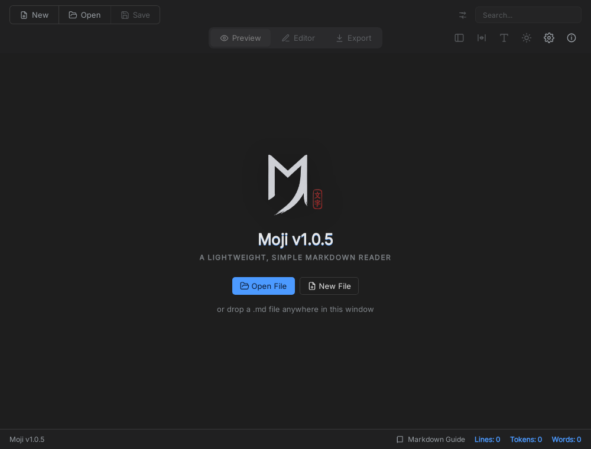

# Moji boot on the experimental Linux native host

Date: 2026-10-21 JST
Status: **experimental boot evidence. `compatible:false`, strict BLOCKED, original preload NOT_EXECUTED.**
Report: [`compatibility/reports/moji-linux-boot.json`](../compatibility/reports/moji-linux-boot.json)
Host: [`docs/0057-linux-native-host.md`](0057-linux-native-host.md)

## Result

The pinned Moji v1.0.5 main (`out/main/main.js`, SHA-256
`41cd703c...f7046e`) and its real Vite renderer boot on the Linux
GTK3/WebKitGTK host. The real main executes on QuickJS, the generated adapted
page API dispatches the renderer's initial calls to Main, and the initial Moji
UI is visible in a WebKitGTK window.



This is **not** an app-acceptance result. The Linux host does not implement the
file broker, main fs, dialogs, export, grant persistence, the original preload
or native frame authority. The screenshot is the initial UI only; no human
Open/Save/Export/IME/restart action was exercised.

## Reproduce

Prerequisites:

1. The pinned Moji build from `compatibility/apps/moji-v1.0.5/target.json`
   (`b7b1d58...`) with `out/main/main.js`, `out/preload/preload.js`,
   `out/renderer/` and `samples/markdown-guide.en.md`. The hashes must match
   `build-provenance.json`.
2. `node scripts/build-linux-host.cjs` (GTK3 + WebKitGTK 4.1 development
   packages, X11 display).
3. `moon build --target native native/nodeless` (the harness also builds it).

```sh
ELECTRON_MBT_MOJI_ROOT=/path/to/pinned/moji \
  DISPLAY=:10.0 \
  node scripts/nodeless-moji-linux.cjs
```

The harness verifies the main/preload/adapter hashes, stages the app with the
generated adapter and a schema-2 source manifest, runs the real main with
`--window --entry out/main/main.js` under a fake `node` on `PATH`, and writes
the report only on a real PASS. The test `tests/moji-linux-boot.test.cjs` runs
the same harness when the pinned source and Linux host are present; it skips
otherwise.

## Observed report

| Field | Value |
| --- | --- |
| status | **PASS** (boot only) |
| platform / arch | linux / x64 |
| page title | `Moji v1.0.5` |
| page URL | `electron-mbt-app://app/out/renderer/index.html` |
| renderer loaded | true |
| document generation | 1 |
| adapted observed / released | true / true |
| adapted requests / reply errors | 2 / 0 |
| ingress admitted / denied | 2 / 0 |
| main error | empty |
| host shutdown / live leases / node processes | true / 0 / 0 |
| preload executed | false |
| broker | `NOT_IMPLEMENTED` |
| human input | false |
| compatible | false |

Recorded hashes:

- main `41cd703c...f7046e`
- preload `bd0f47d6...c544`
- renderer index `fafe339f...e301`
- adapter `bdfe8bdd...7501`
- host `6479893a...2dd4`

## Keep the window open

The automated harness exits after the boot report. For an interactive window
that stays open, pass `--hold` (optionally with a bounded `--hold-seconds`):

```sh
ELECTRON_MBT_MOJI_ROOT=/path/to/pinned/moji \
  DISPLAY=:10.0 \
  node scripts/nodeless-moji-linux.cjs --hold

# Bounded smoke run:
node scripts/nodeless-moji-linux.cjs --hold --hold-seconds 2
```

The nodeless runtime prints a `HOLDING` JSON line with the page title/URL and
host PID, then keeps pumping app-request/app-reply events until it is
terminated, `--hold-seconds` expires, or the GTK window is closed. A user close
now ends the hold with `HOLD_EXIT` / `reason:"window-closed"`; `app.quit` and
menu/tray semantics remain partial. The hold mode is mutually exclusive with
the selftest flags. The Moji window was kept open and captured with the initial
UI; exact-file open/save and app-local fs are implemented separately in
[docs/0059](0059-linux-file-and-close.md), but the human Moji Open/Save flow has
not been recorded as an acceptance result.

## Environment

| Item | Value |
| --- | --- |
| OS | Ubuntu 24.04, Linux 7.0.0 x86_64 |
| Display | X11 `:10.0` |
| GTK | 3.24.41 |
| WebKitGTK | 4.1, 2.52.6 |
| Node | 24.22.0 (local; CI pin is 24.21.0) |
| MoonBit | 0.1.20261016 (local; CI pin is 0.1.20261012) |
| Screenshot | XWD capture of the 1000x760 WebKitGTK content window, converted to PNG |

The local `npm test` with the pinned source and Linux host present:
**502 tests / 471 PASS / 0 FAIL / 31 SKIP**. The `linux-native` CI job runs
the shared fixture tests plus the Linux fs/dialog/close tests, but this Moji
boot harness is **NOT RUN in CI** because the pinned Moji source is not fetched
there. The macOS Moji suite is also **NOT RUN for this Linux result**; Linux is
not macOS/WebKit evidence.

## Limits / not verified

- Exact-file open/save and app-local main fs are implemented (docs/0059),
  including host-loss SIGPIPE handling and a read-only-filesystem error code;
  directory grants, multi-select/filters, overwrite-confirmation UI, grant
  persistence/revocation, export/print, updater behavior and zlib streams are
  not implemented or NOT RUN. A save target on a read-only mount (for example
  `~/Downloads` here) returns `ELECTRON_MBT_FILE_READ_ONLY`; use a writable
  workspace path.
- The human Moji Open → edit → Save flow is NOT RUN; the dialog plumbing is
  covered by CI auto-selection tests, not by a human acceptance run.
- Human file selection, IME, editing, save, export and restart are NOT RUN.
- The original preload is NOT_EXECUTED; the generated adapted page API is used.
- Native main-frame sender/frame authority is unproven (WebKitGTK does not
  expose `WKScriptMessage.frameInfo` in its UI-process API); see
  [open issue 0022](../issues/open/0022-linux-native-frame-authority.md).
- The GTK window title is empty because the Linux host does not propagate the
  WebView title to the native window title; the page title is `Moji v1.0.5`.
  This is a host/UI parity gap, not an app failure.
- No profile, readiness or A–J row is promoted. `compatible:false`, strict
  BLOCKED and original preload NOT_EXECUTED remain.

## Next

1. Add the Linux file broker / main fs / dialog / export services with the same
   grant and lifetime contracts as macOS, then drive the real Moji Open/Save/
   Export actions.
2. Add a human-input lane and a document-scoped grant/revocation test.
3. Resolve or explicitly restrict the native frame authority in
   [open issue 0022](../issues/open/0022-linux-native-frame-authority.md).
4. Keep the macOS suite as the reference; do not substitute this Linux boot for
   macOS acceptance or Electron compatibility.
