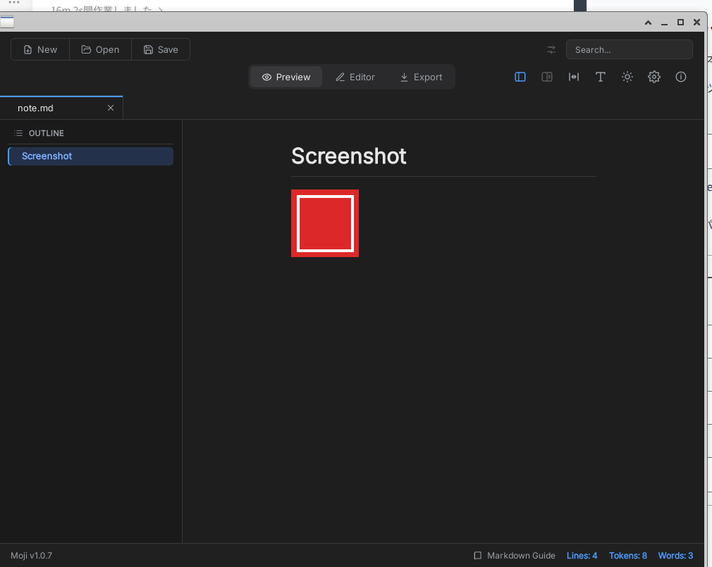

# Custom protocol asset broker (adapted profile)

Status: **Linux experimental implementation; `compatible:false`.** The pinned
Moji 1.0.7 renderer requests a relative image and the native host serves it
through a runtime-owned broker. jmd's privileged `bypassCSP` declaration is
rejected at main evaluation in a synthetic J1 fixture. The pinned jmd main is
also rejected before any window, but earlier: the CJS loader refuses the
`JMD_SMOKE` computed require, so the protocol gate is not reached. A separate
adapted staged copy removes that dev hook and `bypassCSP` and now reaches a
positive jmd boot/open/preview/edit/save ([docs/0075](0075-jmd-positive-adapted.md)).
macOS is **NOT RUN**. This is not Electron protocol compatibility.

## What changed

`electron.protocol` is no longer a silent no-op in the adapted profile.

- `protocol.registerSchemesAsPrivileged(list)` validates the scheme name, the
  staged `assetSchemes` admission and the requested privileges.
  - allowed: `standard`, `secure`, `supportFetchAPI`, `corsEnabled`
  - rejected with `ELECTRON_MBT_UNSUPPORTED_PROTOCOL_PRIVILEGE`: `bypassCSP`,
    `allowServiceWorkers`, `codeCache`, `stream`, unknown keys, non-boolean
    values
  - a scheme absent from the stage fails with
    `ELECTRON_MBT_PROTOCOL_SCHEME_NOT_ADMITTED`
- `protocol.handle(scheme, handler)` records the handler but **never executes
  it**. The status reports `handlerExecuted:false`.
- The CLI sends the staged scheme list to the native host before main
  evaluation (`set-asset-schemes`). The host registers the schemes at
  `create-window`, before the first WebView exists.
- The host serves `scheme://local/<percent-encoded absolute path>` from the app
  root and session-scoped document directories. A dialog selection adds the
  selected document's canonical parent directory as an image-only asset
  directory; it does not widen the exact-file write grant or the main fs
  directory grants.
- Responses carry a status (`200`/`400`/`403`/`404`/`405`/`413`/`415`),
  `Content-Type`, `Content-Length`, `Cache-Control: no-store`,
  `X-Content-Type-Options: nosniff`, `Access-Control-Allow-Origin: *`, and a
  restrictive CSP for SVG. The header-bearing WebKitGTK API takes ownership of
  the `SoupMessageHeaders`; unreffing them was the host abort seen in the
  first attempt.

## URL and path policy

- Host must be `local`; query and fragment are rejected.
- The path is percent-decoded once, must be absolute after decoding, and is
  rejected on `..`, NUL, invalid UTF-8 or a path longer than 4096 bytes.
- `realpath` is resolved on the host and must be inside the app root or an
  asset directory.
- Extension allowlist: png, jpg/jpeg, gif, webp, avif, bmp, ico, svg.
- Regular file only, opened with `O_NOFOLLOW|O_CLOEXEC`; `fstat` is checked
  before reading. The cap is 4 MiB.
- GET and HEAD only. Read-only; no directory listing, no network, no writes.

## Evidence

- `node --test tests/asset-protocol.test.cjs` (Linux, real GTK/WebKitGTK
  window): **9 PASS** (8 asset cases + a `loadFile` query fixture).
  - dialog-granted image: page title `asset-ok-1`, host `served:1`,
    `bytes:68`, `denied:0`, `handlerExecuted:false`;
  - ungranted image: page title `asset-error`, `denied:1`,
    `lastCode:"ELECTRON_MBT_ASSET_DENIED"`, `served:0`;
  - unadmitted scheme: main evaluation fails with
    `ELECTRON_MBT_PROTOCOL_SCHEME_NOT_ADMITTED`, no window;
  - traversal -> `ELECTRON_MBT_ASSET_ESCAPE`; symlink escape ->
    `ELECTRON_MBT_ASSET_DENIED`; non-image -> `ELECTRON_MBT_ASSET_TYPE`;
    over-cap -> `ELECTRON_MBT_ASSET_LIMIT`; all `asset-error`, no served
    bytes;
  - `crossorigin="anonymous"` image -> `drawImage` + `canvas.toDataURL`
    succeeds (`canvas-ok-*`), so the CORS header path works for images.
- `node scripts/nodeless-moji-assets.cjs`: **PASS**. The pinned Moji 1.0.7
  main and renderer open a test document with a relative PNG; the host serves
  it (`served:1`, `bytes:68`, `schemes:["moji-asset"]`,
  `handlerExecuted:false`). The page probe did not expose the preview image as
  a plain DOM `` (`rendererProbe.status:"NOT_EXPOSED"`); the controlled
  asset fixture verifies WebKit decoding and `naturalWidth:1`. A separate
  manual run with a 96x96 PNG through the same stage/broker path visibly
  rendered the preview image (not a pixel assertion from the script):
  
  Report: `compatibility/reports/moji-assets.json`.
- `node --test tests/apps/jmd-j1.test.cjs`: **2 PASS** (synthetic).
  `bypassCSP` stops at main evaluation with
  `ELECTRON_MBT_UNSUPPORTED_PROTOCOL_PRIVILEGE`; an unadmitted safe scheme
  stops with `ELECTRON_MBT_PROTOCOL_SCHEME_NOT_ADMITTED`. The unreachable code
  after the declaration is not evaluated.
- `node scripts/jmd-j1.cjs`: **PASS expected-rejection** against the pinned
  `f875fc6` source. The first gate is `ELECTRON_MBT_DYNAMIC_REQUIRE`
  (`computed require in electron/main.js`); `protocolGateReached:false`.
  Report: `compatibility/reports/jmd-j1.json`.
- MoonBit native prelude tests: admission, privilege rejection, unadmitted
  scheme, handler recorded but not executed.
- Existing Node-less Linux fixtures and the Moji 1.0.7 boot remain PASS.

## Limits and deliberate non-claims

- The app's `protocol.handle` handler is not executed. Response bodies,
  redirects, custom status/headers and app-side authorization are replaced by
  the broker policy. This is an adapted-profile behavior, not Electron
  protocol compatibility.
- `fetch()` to the custom scheme still reports a network error in this
  WebKitGTK build, so the status code is not verified through Fetch. The host
  counters (403/413/415 and typed codes) and ``/canvas behavior are the
  evidence. No-cors canvas taint, SVG direct-navigation, range requests and
  conditional requests are **NOT RUN**.
- The CORS/canvas result uses `crossorigin="anonymous"`; whether Moji's own
  diagram export sets that attribute is not verified.
- Asset directories are session-scoped. A persisted exact-file grant alone
  does not authorize images after a restart.
- Single window only. `protocol.unhandle` does not stop the host broker.
- macOS `WKURLSchemeHandler` is **NOT IMPLEMENTED/RUN** in this increment.
  The CLI only sends the host scheme list on Linux, so adapted Moji stages
  still boot on macOS but custom-scheme images are not served there. No
  macOS PASS is claimed.
- The pinned raw jmd J1 is an expected-rejection at the CJS loader, not at
  the protocol declaration; the `JMD_SMOKE` computed require is rejected by
  the static graph builder. The synthetic fixture covers the `bypassCSP`
  path. The adapted staged copy (docs/0075) removes that hook and
  `bypassCSP`, adds a jmd page shim, and passes boot/open/preview plus
  CodeMirror edit + `menu:save`, a polling `fs.watch` reload, a test-injected
  `showMessageBox`, GDK display bounds and `loadFile` query. Multiple windows,
  native menu installation, `shell` and `net` remain NOT RUN.
- `emoon init/migrate/dev/bundle --asset-scheme <scheme[,scheme]>` writes the
  list to `.emoon/config.json` and the staged `nodeless-app.json`. Both the
  native and Node CLIs reject invalid/reserved/duplicate names and more than
  four schemes. `--dry-run` does not write.

## Security notes

- The renderer can name any `moji-asset://` URL. The host checks the canonical
  path against the app root and explicit document directories, so an
  ungranted path is denied before a read.
- The directory grant is image-only for the broker and read-only. Main code
  still cannot read sibling files through `fs` without a separate directory
  grant.
- A document selected directly under `/` does not grant `/` as an asset
  directory; the root directory and the 16-directory cap are rejected.
- `O_NOFOLLOW` plus `fstat` bounds the symlink and replacement window; a
  hostile writer can still swap a file inside an already-granted directory.
  This is a residual risk, not a CAS guarantee.
- `handlerExecuted:false` is recorded in the run report so a broker-served
  image is not mistaken for the app's protocol handler running.
