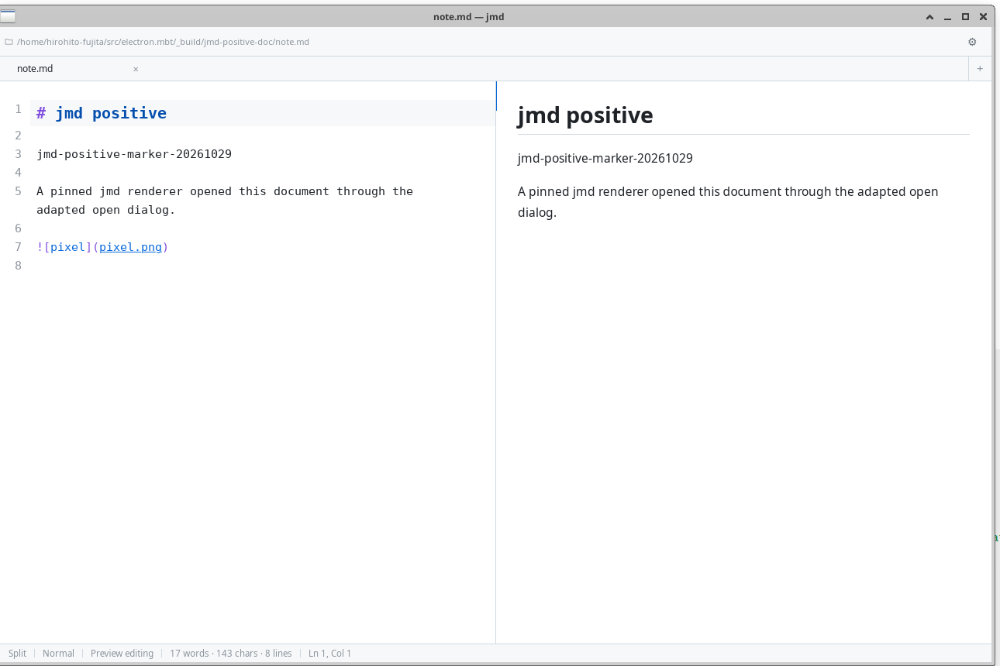

# jmd positive on the adapted Linux profile

Status: **adapted-profile PASS on Linux; `compatible:false`.** Pinned jmd 0.2.3
(`f875fc6`) boots its real Vite renderer in GTK/WebKitGTK, opens a markdown
document through a test-injected native open dialog, renders the marker in the
preview, and loads a relative PNG through the `jmd-file` broker. The original
preload is not executed. Save/edit and macOS are **NOT RUN**.

This is not an Electron-compatibility result and does not unblock the strict
`electron-nodeless-v1` profile.

## What runs

- Pinned upstream source `f875fc616feb89ea803a0fc140ec770a2ade041e`.
- `npm ci --ignore-scripts` + `npm run build` produce jmd's `dist/` Vite
  renderer. The source checkout stays unchanged.
- A staged copy is adapted (see below) and booted through
  `emoon run --window`. The renderer is served as
  `electron-mbt-app://app/dist/index.html`.
- A CLI-only test hook dispatches `test:open-dialog` in main. That calls jmd's
  real `openFileDialog()`; the Linux host opens the real GTK dialog and the
  test harness auto-selects `_build/jmd-positive-doc/note.md`.
- `openPath()` reads the file through the main `fs` facade and sends
  `file:opened`; the renderer opens a tab, sets the window title to
  `note.md — jmd`, and renders the preview.
- The document includes ``. The bespoke page shim's
  `resolveAsset` produces `jmd-file://local/<encoded path>`; the stage admits
  `jmd-file` and the asset broker serves the dialog-granted document-directory
  image. The probe sees `naturalWidth:1`.

## Staged adaptations

All edits are on `_build/jmd-positive-stage`; the pinned checkout is untouched.
`compatibility/reports/jmd-positive-adaptation.json` records the source and
adapted SHA-256s and each before/after snippet.

| Edit | Why |
| --- | --- |
| Remove the `JMD_SMOKE` block | It contains a computed `require`; the static CJS graph builder rejects it with `ELECTRON_MBT_DYNAMIC_REQUIRE` before protocol registration. |
| Remove `bypassCSP: true` from the `jmd-file` scheme | The adapted admission rejects `bypassCSP` with `ELECTRON_MBT_UNSUPPORTED_PROTOCOL_PRIVILEGE`. The scheme remains `standard`, `secure`, `supportFetchAPI`. |
| Add `ipcMain.handle('test:open-dialog')` | CLI-only test hook to drive the real open dialog; the renderer never calls it. |
| Bespoke `window.jmd` page shim | Linux has no original-preload execution. It implements the preload's IPC calls, pure `basename`/`resolveAsset`, and the event listeners. IPC dispatch stays runtime/MoonBit-owned. |
| `nativeTheme` facade | jmd reads `shouldUseDarkColors` at window creation. The facade returns `false` and exposes inert listener methods. |

The original `electron/preload.js` is copied for provenance but is
**NOT_EXECUTED**; `webUtils.getPathForFile` is fail-closed in the page shim.

## Evidence

- `node scripts/jmd-positive.cjs`: **PASS**.
  - `compatibility/reports/jmd-positive.json`:
    `adaptedBoot:true`, `windowTitle:"note.md — jmd"`,
    `openDialog:true`, `previewMarker:true`, `assetServed:true`,
    `imageLoaded:true`, `handlerExecuted:false`.
  - Assets: `schemes:["jmd-file"]`, `requests:1`, `served:1`,
    `bytes:68`, `denied:0`, `handlerExecuted:false`.
  - Preview text:
    ```
    jmd positive

    jmd-positive-marker-20261029

    A pinned jmd renderer opened this document through the adapted open dialog.
    ```
- The same stage in a manual run:

  

- CI: `.github/workflows/ci.yml` checks out the pinned jmd source, runs
  `npm ci --ignore-scripts` + `npm run build`, and runs the smoke under Xvfb.
  `CI=true` makes a missing source/build a hard failure instead of a skip.
  GitHub Actions run 279 (`e543164`, `linux-native`) completed successfully,
  including the jmd checkout/build and positive smoke steps.

## Reproduction

```
node scripts/jmd-positive.cjs
```

The script requires:
- `_build/jmd-positive-src` (or `JMD_SOURCE`) at the pinned revision with
  `dist/index.html` built;
- a built `dist/emoon` or `_build/native/debug/.../emoon`;
- `dist/emoon-host` for the Linux display.

It builds the stage with `scripts/jmd-adapt.cjs`, drives the open dialog, and
writes `compatibility/reports/jmd-positive.json`.

## Limits

- The open dialog is test-injected; no human picker or IME.
- Save/edit is **NOT RUN**. The open dialog grants exact-file readwrite, and
  `file:save` exists, but no edit was injected into CodeMirror and no save was
  verified.
- `fs.watch` is a typed `ELECTRON_MBT_UNSUPPORTED_API`; jmd catches the throw
  on this path and no file-change delivery is claimed. `dialog.showMessageBox`,
  `screen.getDisplayNearestPoint`, `net`, menu installation and `loadFile`
  query are not exercised.
- jmd's `protocol.handle` is recorded, not executed; the broker owns the
  response. This is an adapted-profile substitution.
- macOS is out of scope.
- `compatible:false`; strict profile remains blocked; original preload
  NOT_EXECUTED.
