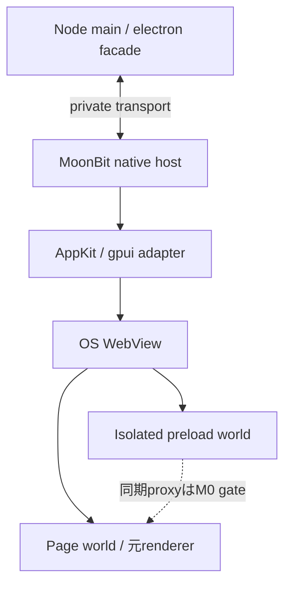

# 0001: Electron API 互換・軽量ランタイム electron.mbt の設計

Status: open
Model: GPT-6 Astra Pro
Created: 2026-10-09
Updated: 2026-10-17
Branch: feat/issue-0001-strict-m0

## 概要

実 Node.js と system WebView を使い、既存 Electron app の main/preload/renderer の意味とソースを保つ `desktop-core-v1` の要求正本を整える。M0〜M4 と受入 A〜J を維持し、Node-less adapted の製品計画は [0004](0004-production-readiness-roadmap.md) で並行管理する。

| 分類 | 内容 |
| --- | --- |
| 作業の性質 | 実装・feasibility 調査を束ねる親 issue。単一 PR の実装指示ではない |
| 優先度 | P0: M0 の判定器・同期性・隔離。後続は M1〜M4 の順 |
| 利用者への影響 | アプリ source を保って起動できる範囲、拒否する API、必要な配布依存を正しく判断できる |
| 現行の入口 | `core/`、`bridge/`、`bridges/node/`、`cmd/electron-mbt.cjs`、`compatibility/manifest.json`、macOS probes |
| 変更履歴への影響 | 原設計の番号・A〜Jを保持。互換保証を縮小したことにして残作業を消さない |

## 背景

原設計は 2026-10-09、main `68a216d7371a6241ec57bd5290743a13666efcef` に README のみがある時点で作成された。その後 M0 core・Node facade・probes・静的 CLI が追加された。最新の実装状況は [README](../../README.md)、[progress](../../docs/0001-progress.md)、[manifest](../../compatibility/manifest.json) と [0005 の固定 PR 台帳](0005-existing-work-and-integration.md) を根拠にする。

2026-10-17 のロードマップ追加 commit `8177cf0` は設計文書の追加であり、未 merge の PR #2/#3/#8〜#13 を取り込んだものではない。初期製品の対象は macOS / Apple Silicon。Windows/Linux は別の適合試験を経て追加する。

## 問題

現行 main は `compatible:false` で、実 Electron app を run/pack できない。CJS identity、MoonBit 状態機械、private sync transport、WebView world probe が存在しても、実 native host・安全な cross-world sync proxy・native sender・実アプリ操作を結んだ経路は受入済みではない。

最初に修正するのは観測欠落を成功として扱い得る evidence admission である。PR #6 の `observed:{}` 負例が現行 validator を通ることは0005で再現され、#8 の baseline 修正は未 merge。判定器の修正前に新たな互換実績を積むと、M0 の結論自体が信頼できなくなる。

## 目標

### 1. 解く問題と成功条件

Electron は Chromium と Node.js を組み込むデスクトップアプリ基盤である。[S01] electron.mbt は別の UI 記法への書き直しを前提とせず、既存の `main`、`preload`、HTML/CSS/JavaScript を扱う Electron Compatibility Runtime とする。

軽量化の仮説は「MoonBit なら小さくなる」ではなく、**OS / システム側の WebView を利用して、アプリごとの Chromium 同梱を省ける**ことである。Node.js、互換ブリッジ、WebView の導入依存は残る。配布サイズ削減からメモリ削減を推定しない。

1. 対象プロファイル内の Electron アプリを、アプリソースと renderer 配布アセットを変更せず起動する。
2. API 名だけでなく、戻り値、同期・非同期、イベント、例外、破棄後の動作を対象 Electron と比較する。
3. 同じアプリを Electron と electron.mbt で release ビルドし、軽量化を数値で示す。
4. 特権を renderer へ漏らさず、非対応を黙って無視しない。
5. 実アプリ単位の互換実績を積み上げ、対応範囲を段階的に広げる。

## 対象外

初期対象外は、配布済み Electron 実行ファイルのバイナリ差し替え、全バージョン・全アプリ互換、Chromium/Blink の再実装、Node.js 自体の MoonBit 再実装、React/DOM から gpui.mbt への自動変換、iOS/Android 対応である。既存 Electron インストーラー、ASAR、ネイティブアドオンの無変更再利用も初期の保証には含めない。

Node-less 化、生成 preload adapter、atomic-save adaptation は0004以降の明示した profile で扱う。本書の無改修要件をそれらで達成したことにしない。個別 API の初期 unsupported は§7に残す。

## 提案する方針

### 最初の変更単位と実装の入口

| 順序 | 入力 → 変更 → 観測する出力 | 既存ファイル / 依存 |
| --- | --- | --- |
| 1 | 固定 baseline と欠損観測 → semantic admission の修正 → 欠損/null/wrong type を理由付き拒否 | EP-01、0005。 `scripts/differential.cjs`、`scripts/macos-probe.cjs`、`tests/macos-probe-validation.test.cjs` と PR #8 |
| 2 | 元 PR の contract と最新 main → core/native stack を別々に統合 → exact SHA の回帰・差分台帳 | EP-02〜04、0005。0004/0020で指定する依存順、#4/#7 の既存挙動と pin を保全 |
| 3 | 固定 OS/SDK/公開 API と原本 preload → 有限 strict spike → Go/No-Go/不足証拠の列挙 | EP-07、0007。Main sync RPC と cross-world sync bridge を別 fixture にする |
| 4 | 成立した contract → native lifetime / IPC / services の各 PR → A〜Hの実 backend 証拠 | 0009〜0012。native metadata と core ownership の接続が前提 |
| 5 | 同じ source/profile/artifact → 実アプリ・配布・計測 → I/Jと残る制限 | 0014〜0017。strict/adapted の証拠を混用しない |

最初の PR は1の再現と修正だけを対象にできる。M0全体を解決するまで小さい修正に着手できないという意味ではない。新規配置の詳細は§15、公開 API と内部 envelope は§7〜§10を使う。

### 2. 「互換」の定義と表示

#### 2.1 対象を固定する

M0 で比較対象 Electron の正確なバージョン、公式ソースの tag/commit、対応 Node.js、MoonBit toolchain、gpui.mbt commit、OS/SDK/CPU を固定する。`latest` や範囲指定だけでは適合判定しない。2026-10-17 の現行 manifest は core oracle を Electron 44.7.0 / embedded Node 24.21.0、MoonBit を moon 0.1.20261012 / moonc v0.10.15+943464bfa に固定している。OS/SDK/WebView は未固定で、pin の存在を適合実証にしない。

既存の `compatibility/manifest.json` を拡張し、API・引数/オプション・イベント・利用プロセス・値型・OS・WebView バージョン・fixture・証跡を結び付ける。行の状態は `planned` / `partial` / `verified` / `unsupported` とし、`verified` には実行結果を必須とする。スキップは PASS ではない。

#### 2.2 異なる互換性を混同しない

| 軸 | 判定対象 |
| --- | --- |
| モジュール/API | `require('electron')`、将来の ESM import、メソッド・プロパティ・イベント |
| 振る舞い | 同期戻り値、Promise、イベントの先後関係、例外、キャンセル、寿命 |
| Web | HTML/CSS/DOM/Web API。OS WebView と Electron の差異は別管理 |
| Node | Node 組み込み API、npm 依存、Electron 固有の `process` 拡張 |
| 配布 | launcher、production 依存、リソース配置、署名、更新、インストーラー |
| 実アプリ | アプリの特定 revision と操作シナリオに対する無改修動作 |

`Core Compatible (<profile>, <Electron version>, <platform>)` は明示したサブセットの適合を意味し、Electron 全体の互換を意味しない。`App Compatible` はアプリ revision・テストシナリオ・設定変更の記録を伴う独立の判定とする。少数デモの成功を API 全般の対応率に換算しない。

「無改修」はアプリの main/preload ソースと renderer 配布アセットのハッシュ一致で確認する。launcher、パッケージ設定、ランタイム依存の変更は許容するが必ず記録する。新しい bundler 設定や再ビルドを要求した場合は、その変更を別欄に記録し、「配布アセット無変更」とは表示しない。

### 3. 基本アーキテクチャの決定

| 決定 | 内容と理由 |
| --- | --- |
| MoonBit-first | 互換状態機械、API 検証、権限、ID/寿命、メッセージ契約、診断を MoonBit で所有する |
| 実 Node.js を利用 | 既存 main と npm コードを実行する。Node API の独自再実装を初期課題にしない |
| システム WebView | macOS は WKWebView、Windows は WebView2 Evergreen、Linux は WebKitGTK を候補とする |
| Chromium 非同梱 | 標準プロファイルに Electron/CEF/固定ブラウザエンジンを隠して含めない |
| 独立リポジトリ | Electron 固有契約を gpui.mbt の core に持ち込まない |
| 薄い外部言語境界 | JavaScript は loader・関数 proxy・WebView 接続、C/ObjC/C++ は OS/Node 接続に限定する |

Node.js を選ぶのは main の互換性を優先するためである。Bun/QuickJS 等への置換は、同じ試験とサイズ比較を通す将来の別 backend とし、初期設計では同等互換と見なさない。

WKWebView と WebView2/WebKitGTK は実在する Web コンテンツのホストだが、そこから Electron の `webContents` や `contextBridge` がそのまま実装できるとは言えない。[S10][S11][S12] **WebView を起動することと安全な Electron 互換ブリッジを提供することは別の達成条件**である。

### 4. プロセス・言語・所有権の境界



1. native host の OS UI スレッドがウィンドウ・WebView・メニュー等を所有する。コールバックで UI スレッドを待ち続けない。
2. Node.js は main を実行する子プロセスとし、Node と OS のイベントループを初期段階で同一スレッドへ埋め込まない。
3. JavaScript 関数・クロージャ・listener identity はその JS realm が所有する。MoonBit へ関数本体をシリアライズしない。
4. UI の実状態と native handle は native host が所有する。Node 側 facade は論理 ID を持ち、未確認キャッシュを同期 getter の真値として返さない。
5. preload は WebView の隔離 realm で実行する。main の Node.js をそのまま renderer へ公開しない。
6. 同じ状態機械を JS と MoonBit に二重実装しない。JS 上に必要な portable logic は MoonBit の JS target を使う構成を検討し、手書き JS は leaf adapter に限定する。

このプロセス構成は**最初に検証する候補**である。M0 で同期 API と隔離 bridge が成立しなければ、別のプロセス/埋め込み構成を ADR で比較する。破綻した構成を維持するために API を黙って非同期化しない。

### 5. gpui.mbt との関係

確認した gpui.mbt の `migration/host_services/` は要求/完了、権限、キャンセル、古い完了の破棄を提供する基盤であり、実 Electron/Tauri アプリ移行の証拠ではない。native handle、DOM、特権の直接実行を portable package に持ち込まない境界が定義されている。[S13][S14]

再利用候補は lifecycle、diagnostics、capability、host-service 契約、ウィンドウ・OS service adapter とする。gpui.mbt に汎用 WebView 埋め込み API が完成済みとは仮定せず、native view の attach/detach、focus、resize/DPI、破棄、callback lifetime を新規契約として設計する。

gpui.mbt の GPU 描画・flex layout で任意 HTML/CSS を描き直すことはしない。Web 部分の layout/描画/IME/accessibility は WebView が担当し、その実際の操作を各 OS で検証する。gpui.mbt の native control の完成を Web UI 起動の必須条件にしない一方、WebView を使っただけで IME やアクセシビリティが PASS になったとも見なさない。

依存方向は `electron.mbt -> gpui.mbt の公開契約` とし、逆向き依存は作らない。host-service の bounded JSON 契約は OS サービス制御に再利用できても、Electron の汎用 Structured Clone IPC の完全代替にはしない。gpui.mbt への変更が必要になった場合は別の小さな変更として提案する。本設計追加では gpui.mbt を変更しない。

### 7. 初期互換プロファイルと拡張順序

初期プロファイル名を仮に `desktop-core-v1` とする。M0 の tiny fixture と、M1/M2 で目指す公開サブセットを混同しない。**以下はすべて実装予定であり、対応済み表ではない。**

| 領域 | M1/M2 の対象候補 | 明示する制限・後続項目 |
| --- | --- | --- |
| main loader | CommonJS、`package.json.main`、`require('electron')` | ESM と `electron/main` 等の subpath は別試験で追加 |
| `app` | `whenReady`、`isReady`、`quit`、`getName`、`getVersion`、`getAppPath`、`isPackaged`、`getPath` の列挙した種類 | ready/activate/window-all-closed/before-quit/will-quit/quit の順序は OS 別。single-instance は後続 |
| `BrowserWindow` | width/height/title/show、preload と安全な webPreferences、`loadFile`、`show/hide`、`close/destroy`、`isDestroyed`、`getBounds`、`getAllWindows` | parent/modal、transparent、offscreen、native handle、全オプション互換は含めない |
| `webContents` | `id`、`send`、`did-finish-load`、`did-fail-load`、最小 sender 情報 | `ready-to-show` は独立 gate。DevTools/CDP/`debugger`/`executeJavaScript` 等は後続または対象外 |
| IPC | `ipcMain.handle/removeHandler/on/once`、`ipcRenderer.invoke/send/on/once/removeListener` | 同期 renderer IPC、MessagePort transfer、全イベント引数互換は別項目 |
| preload | sandboxed CJS の `require('electron')`、列挙した globals/modules | Node 全機能を preload へ出さない。ESM preload は初期対象外 |
| `contextBridge` | `exposeInMainWorld` の明示した値型・関数/Promise/callback profile | 同期性と隔離の M0 適合が前提。任意 world ID 等は後続 |
| OS services | `dialog.showOpenDialog/showSaveDialog` の基本形、`shell.openExternal` の許可 URL、`clipboard.readText/writeText` | 同期 dialog、全 file filter/options、画像 clipboard 等は後続 |
| 日常利用拡張 | 基本 `Menu`、`Tray`、通知、shortcut、複数ウィンドウ | M3 以降、必要な実アプリから優先順位を決める |

sandboxed preload が Node.js の全環境ではなく限定された require/globals を持つこと、main と preload の ESM 条件が異なることは Electron の仕様に従って対象バージョンで固定する。[S03][S04]

M0 は静的 HTML と最小 IPC の fixture、M1 は lifecycle/window、M2 は preload/IPC/ファイル選択を含む一連の操作を目指す。React や特定 UI framework への依存は追加しない。

初期 `unsupported` とするものは `nodeIntegration: true`、`contextIsolation: false`、`sandbox: false`、`webSecurity: false`、unsandboxed preload、`ipcRenderer.sendSync`、`<webview>` tag、Chromium extensions、CDP 互換、`session.webRequest` 完全互換、独自 protocol API 全般、DRM、desktop capture、Electron native addon ABI、autoUpdater、ASAR 仮想 filesystem である。これらは黙って無視せず、実行前診断または最初の利用時に非対応を示す。

### 8. モジュール解決とアプリロード

1. launcher が app root、`package.json`、main entry、production 依存、互換 manifest を読み、Node/WebView が利用可能か診断する。
2. 実 Node.js を固定バージョンで起動し、main を評価する前に `electron` の解決を facade に接続する。アプリ source の文字列置換や node_modules の破壊的書き換えはしない。
3. アプリ本体だけでなく、依存 package 内からの import/require と module identity も試験する。CJS の成功を ESM loader の成功と見なさない。
4. Node の通常 API は実 Node に委譲し、`process.type`、`process.resourcesPath` 等の Electron 拡張は項目別に追跡する。実際の engine バージョンを偽って native addon の検査を回避しない。
5. preload は document-start と隔離 world の条件を確認して評価する。ページの最初の script より遅れて API が生える実装を互換としない。

Node-API の ABI 安定性と、Electron/V8 に直接依存するアドオンの ABI は分ける。Node-API のみを使うアドオンでも OS/CPU/依存ライブラリを検証し、Electron 向けバイナリがそのまま使えるとは保証しない。[S08][S09] 初期は pure JS の main 依存を中心にし、アドオンは発見・非対応報告を先に実装する。

`loadFile` は app root 内の実ファイル、相対リソース、query/hash、`location`、CSP、CORS、storage origin を試験する。内部 custom scheme や localhost へ移した場合の origin/URL 変化を隠さない。透過的に再現できないケースは制限として記録する。ASAR や Electron インストーラーの展開・流用は MVP と分離する。

### 9. IPC・値・寿命の契約

Electron IPC は Structured Clone を使用し、関数等には送信制限がある。[S06] 制御メッセージの JSON 化と、アプリ引数の意味保存を区別する。`JSON.stringify` の結果を汎用 IPC 互換と称しない。

初期 tiny fixture では plain record/array/string/boolean/finite number/null に値型を限定できる。ただし `undefined`、配列の穴、非有限数、BigInt、Date、Map/Set、ArrayBuffer/typed array、循環参照、Error 等は失われるまま通さず、対応/拒否を型ごとに試験する。公開サブセットの値型制限を manifest に載せ、拡張時は両 runtime で同じ fixture を実行する。IPC の clone と contextBridge の関数 proxy は別 codec/契約とする。

private transport の envelope は、protocol version、request ID、sender/target の論理 ID、window/frame ID、document generation、operation/channel、payload、completion/error を含む。renderer 由来の ID や origin は信用せず、host が観測した送信元に置き換える。

1. request は success/failure/cancelled のいずれか一度だけ終端化し、重複完了を診断する。
2. window close、navigation、reload、runner 終了で関連 callback/listener/pending request を無効化する。副作用を巻き戻したことにはしない。
3. 同一 sender/channel の保証対象順序を保持する。異なる channel/process 間の全順序や wall-clock 一致を要求しない。
4. payload 長、ネスト、pending 件数、queue byte 数を制限し、超過を typed error で返す。具体値は M0 で測定し manifest に固定する。
5. transport 停止の watchdog と、ユーザー操作/任意の async handler の完了期限を分ける。未完了処理を恣意的な短時間で成功扱い・再実行しない。
6. 同期 API は throw、非同期 API は reject 等、公開面の失敗経路を参照 API に合わせる。独自非対応診断には `ELECTRON_MBT_UNSUPPORTED_API` 等の識別子を付ける。

主な内部状態機械は `App: Booting -> Ready -> Quitting -> Stopped`、`Window: Creating -> Live -> Closing -> Destroyed`、`Document: Loading -> Active -> Invalidated` とする。close/quit がキャンセルされた場合は元の状態に戻す。内部状態名を Electron の公開イベントとして増設しない。

### 10. セキュリティ境界

信頼するのは利用者がインストールした main/preload と runtime であり、renderer の内容・XSS・外部ページ・iframe を特権主体として信用しない。これは「悪意ある Node main を sandbox で閉じ込める」設計ではない。main が直接使う `node:fs` 等まで host-service policy で制限できるとは主張しない。

Electron の sender 検証、context isolation、navigation 制限に関する指針を参照し、以下を electron.mbt の受入要件とする。[S07]

1. renderer は公開された限定 API のみ利用する。Node/OS raw handle、汎用 eval、全チャネル送信ブリッジを自動公開しない。
2. host service は初期拒否と明示 grant を基本にする。アプリ固有 IPC は trusted preload と channel registry で制限し、必要な追加 policy 設定は互換判定に記録する。
3. sender の WebView/frame/document generation と実際の origin を検証する。URL 文字列だけで about:blank、opaque origin、redirect、破棄済み frame を信頼しない。
4. remote navigation/new window/iframe への privileged preload 継承を初期拒否する。許可する場合も別 origin policy と試験を必須とする。
5. `shell.openExternal` は scheme と引数を検証する。ファイル経路は root、正規化、symlink 等の逸脱を扱い、既存 policy 外のアクセスを黙認しない。
6. bridge channel は inherited pipe / OS 権限付き private IPC を用い、公開 TCP listener を標準にしない。診断ログに cookie、token、ファイル内容、無加工の IPC payload を出さない。
7. WebView の sandbox とアプリ側 capability policy を分ける。`sandbox: true` を受け付けるだけで Electron と同一の OS sandbox が実証されたとは表示しない。

isolated world とページは DOM を共有し得るため、DOM 属性・CustomEvent・page 可読の nonce を特権認証の根拠にしない。CSP/隔離/署名/証明書検証の無効化を、互換性の問題の解決策にしない。

### 11. OS backend と配布

| OS | backend 候補 | 個別に必要な検証 |
| --- | --- | --- |
| macOS | AppKit + WKWebView。gpui.mbt adapter 経由の window/service 契約 | isolated world/同期 proxy、メインスレッド、Dock/activate、IME、署名/notarization |
| Windows | Win32 + WebView2 Evergreen | engine 有無、offline 導入、frame/bridge isolation、COM lifetime、DPI/IME、署名 |
| Linux | GTK + WebKitGTK、Wayland を優先 | distro 依存、GTK event loop と gpui.mbt の接続、Web process sandbox、IME、clipboard |

Windows の Evergreen は共有 runtime であり、初回導入が必要な場合がある。Fixed Version は別途 engine を同梱する方式で、標準の軽量 profile と混ぜない。[S11] Linux の WebKitGTK が全環境に存在するとも仮定しない。[S12]

開発時に system Node を使うモードは許容するが、利用者向け既定配布は固定した Node runner を含める。Node が必要なのにサイズ集計から除外しない。WebView 不足時は原因と導入方法を示し、無断の runtime download はしない。offline installer は依存込みで別測定する。

production package には launcher、MoonBit host、Node runner、薄い bridge、app assets、production dependencies、互換/runtime manifest、ライセンス通知を含める。Electron/CEF、devDependencies、SDK、テストデータの混入を検査する。署名、dependency checksum、SBOM、Node/bridge のセキュリティ更新責任を runtime 側で持つ。OS WebView の更新で互換性が変わるため、その version も報告する。

初期は独立した app ID / userData directory を使用し、既存 Electron アプリの実データを上書きしない。データ移行と既存 Electron 版への切り戻しは、バックアップと明示操作を伴う後続機能とする。自動更新 API の未対応を、署名済みパッケージを作れたことだけで対応済みにしない。

### 14. 実装する順序

1. **M0: 互換性・サイズの feasibility gate。** バージョン固定、最小 fixture、同期 main API、隔離 world/sync contextBridge、参照 Electron baseline を実証する。ここが未達なら対象を狭めるか構成を再設計し、後続の互換実績を宣言しない。
2. **M1: MoonBit core と一つの実 WebView。** app/window state、ID、CJS facade、private transport、macOS backend、load/close/quit を実装する。
3. **M2: セキュアな preload と日常の一連操作。** contextBridge/IPC、診断、dialog/clipboard、値型制限と negative tests を揃える。A〜H の対象項目を実機で通す。
4. **M3: 実アプリ・配布の成立。** 対象 Electron アプリを固定し、必要な Menu/Tray 等だけ追加する。署名済み配布、production 依存、サイズ測定、J を検証する。M0/M2 の最小 fixture 成功だけではここを完了にしない。
5. **M4: Windows/Linux と互換面の拡張。** OS 別 gate、ESM、追加 Node/native module、session/protocol/packaging 等を実需要順に増やす。OS 間の未実行結果を横展開しない。

各段階は短い review 可能な変更に分け、互換行・テスト・測定証跡を同じ変更で更新する。制限を緩めるための安全性低下、成果物サイズの隠蔽、unknown を verified にする変更は行わない。

### 15. 想定する構成と CLI

以下は原設計の配置案。2026-10-17 時点で `core/`、`bridges/node/`、`cmd/`、`compatibility/`、fixture/test と macOS probe は存在する。各 directory が存在することを、記載された製品機能の完成とは扱わない。残る package と製品 backend は予定配置である。

| 配置 | 責務 | 現在と残る実装 |
| --- | --- | --- |
| `core/` | MoonBit lifecycle / IDs / errors | 既存の純粋契約を実nativeへ接続する |
| `compat/` | Electron API contracts / state machines | 将来のpackage配置案 |
| `transport/` | envelopes / codecs / flow control | 将来のMoonBit package案。既存Node private transportを重複実装しない |
| `security/` | sender / grants / navigation policy | 将来のpackage案。既存core台帳とactual native ingressの接続が必要 |
| `host_services/` | OS service dispatch | 将来の配置案 |
| `adapters/gpui/` | gpui.mbt公開契約へのadapter | 未作成・gpui未リンク |
| `platform/macos/` | WKWebView / AppKit接続 | 現mainはprobes。製品hostとlifecycleは未統合PR/後続実装 |
| `platform/windows/` | WebView2 / Win32接続 | 未作成。OS別受入が必要 |
| `platform/linux/` | WebKitGTK接続 | 未作成。portable testをGUI対応に数えない |
| `bridges/node/` | Node runner / CJS・ESM resolution / thin Node-API | CJS/facade/private controlのleafは存在。製品runnerとESMは後続 |
| `bridges/preload/` | realm proxy / bounded globals / WebView leaf glue | 将来の配置案。strict同期・隔離のM0を先に判定 |
| `cmd/` | run / doctor / pack / compat-check | 現行は静的診断とrun/pack拒否。製品entryは0013 |
| `compatibility/` | version pin / API・app matrix / known gaps | 既存manifestをprofileと実行証拠へ拡張 |
| `fixtures/` | 同じソースで走るdifferential fixtures | CJS/facade/oracle/worldsは存在。実app/faultを追加 |
| `tests/` | core / integration / security / native E2E | 既存portable/Node回帰と、未作成の製品native/app受入を区別 |
| `benchmarks/` | 配布・メモリ・起動の計測とraw results | 未作成。release artifactと実測を必要とする |
| `issues/open/` | 設計と未解決課題 | 要求と残作業を継続管理 |

製品向け CLI は `electron-mbt run <app-dir>`、`electron-mbt doctor <app-dir>`、`electron-mbt pack <app-dir>`、`electron-mbt compat-check <app-dir>` を目指す。現行 `cmd/electron-mbt.cjs` には `snapshot` と静的 `doctor/compat-check` が実装されている。`snapshot` は成功時 exit 0、静的診断は `compatible:false` / exit 2。`run/pack` は app を評価せず `ELECTRON_MBT_M0_INCOMPLETE` / exit 1 で拒否する。これは実 app の起動・配布機能ではない。`doctor` の静的解析だけで動的 import、reflection、未実行分岐の完全な互換性を保証しない。実行時の API 利用診断と組み合わせる。

## 受け入れ条件

### 13. 適合試験と受入条件

参照 Electron と electron.mbt に同一 fixture を実行する differential test を中心にする。公開 API の操作列、戻り値、例外種別、イベントの必要な先後関係を比較し、PID、時刻、OS に許される表示差を正規化する。異なるエンジンの全 pixel 一致や無意味な全イベント順序一致は要求しない。

| ID | What: 検証すること | 合格に必要な証拠 |
| --- | --- | --- |
| A | 既存 CJS main と依存 package から同じ `electron` facade を取得できる | ソース/アセット hash と module identity |
| B | ready、window 作成、close キャンセル、destroy、quit が契約どおり | 同期戻り値、例外、OS 別 event trace |
| C | preload が先に有効になり、同期/非同期 contextBridge の値と隔離を保つ | 最初の page script、callback解除、prototype汚染の negative test |
| D | IPC が値型、例外、listener、順序を維持する | 値型 matrix、clone error、重複/欠落/遅延注入 |
| E | dialog/file/clipboard 操作が必要な権限内で完了する | fake host test と実 OS 操作の両方 |
| F | 他 frame/旧 document/外部ページから特権を行使できない | sender 偽装、reload race、redirect、破棄済み callback の拒否 |
| G | 日本語入力、コピー、フォーカス、DPI/resize、アクセシビリティが使える | 実 WebView の操作記録。headless のみでは不可 |
| H | Node/host/WebView 異常終了で pending/子プロセスが残らない | fault injection、終端結果、resource/process ledger |
| I | 同じ成果物条件で配布と cold/warm の軽量化を測れる | release artifact、byte 数、全 process 指標、環境 manifest |
| J | 少なくとも一つの実 Electron アプリで代表操作が無改修で通る | app revision、fixture 以外の E2E、許容した設定変更一覧 |

最小 fixture は安全な preload で API を公開し、ファイル選択、テキスト読み込み、描画、保存、再起動、終了まで扱う。実アプリは M0 で使用 API を棚卸しして選定し、適合しない API をテストから除いて「全機能互換」と表示しない。

MoonBit の純粋 core は deterministic unit/property tests、native bridge は integration/fault tests、UI は実機 E2E で検証する。必要に応じて turtles.mbt/hotpath.mbt/vlmkit を評価するが、導入済み・実行済みとは扱わず、画像比較だけで権限や同期性を合格にしない。

### 判定時の共通条件

- [ ] Given 同じ原本 main/preload/renderer と固定 oracle、when A〜J の対象 fixture を両 runtime で実行する、then source/asset hash・必要な戻り値/例外/順序と実行環境を対応付けて差分を説明できる。
- [ ] Given 最初の page script が同期関数を呼ぶ、when 原本 preload の公開 API が実行される、then 同期 return/throw・隔離・callback lifetime の全 required 観測が揃うか、strict gate は未達のままになる。
- [ ] Given forged sender、旧 document、重複完了または上限超過、when production ingress に入力する、then許可していない Main/OS 副作用と旧 realm への配送が0で、requestは一度だけ終端化する。
- [ ] Given 未実装 API・欠損 evidence・別 profile の証跡、when CLI/manifest が適合判定する、then理由付きの拒否または未判定になり、`verified` を生成しない。
- [ ] Given 同一条件の release artifact と実アプリ、when 配布・I/J を判定する、thenNode/共有依存込みの bytes、全関連 process、実操作と原本との差が記録される。
- [ ] `AGENTS.md` のとおり、本 issue は runtime の受入が実際に通るまで open を維持する。設計保存や別 profile の成功を閉鎖理由にしない。

## テスト計画

### 現行の再現コマンドと必要環境

コマンドは repository root で実行する。既存の command と、実装 PR で新規作成する native/app fixture を混同しない。

| コマンド / 方法 | 前提 | 観測と限界 |
| --- | --- | --- |
| `node --test tests/macos-probe-validation.test.cjs tests/manifest.test.cjs` | 実 Node | portable validator と未実装 run/pack の拒否。EP-01では0005の欠損/null負例も追加する。現行 suite の PASS だけでは既知欠陥を閉じない |
| `moon check --target js`、`moon test --target js`、`moon test --target native` | README の固定 MoonBit | core契約のチェック。native UI の成功を意味しない |
| `npm run build` → `npm test` | 固定 toolchain と Node-API headers | compiled core と Node leaf の一致、既存回帰。順序を守り古い生成物を使わない |
| `node scripts/oracle.cjs /absolute/path/to/Electron.app/Contents/MacOS/Electron` | macOS、固定 Electron 44.7.0 / embedded Node24.21.0 | 原本 fixture の baseline と hash。`node scripts/differential.cjs --baseline evidence/electron-baseline.json` の exit 0 は比較完了であり、compatible の意味ではない |
| `node scripts/macos-probe.cjs` と0007/0019の実機操作 | macOS / WindowServer。clipboardを扱うprobeはEP-01のopt-in修正後 | world/sync/native各観測。build-only、headless、skippedを interactive acceptanceへ昇格しない |
| 原本 app / fault / release measurement | 各実装PRが追加する harness と実OS | A〜Jに対応する command、期待値、raw report、対象SHAをそのPRで揃える。現時点は製品経路未実装で NOT RUN |

今回の整備で新たな runtime 成功は主張しない。文書検証、既存 CI、今後の native/app 実行は別の結果として記録する。

### 12. 軽量化の測定計画

次の式は設計上の内訳であり実測値ではない。

```text
Electron package = app + production deps + Chromium + Node + Electron host
mbt package      = app + production deps + Node + MoonBit host + bridge
初回総取得量      = package download + 不足している runtime の取得量
```

両版で同じ app revision/機能/CPU/release 最適化/圧縮条件を使う。比較は最小 fixture と実アプリで分け、巨大な app assets の影響も示す。updater/installer の付帯サイズも同じ定義で扱う。

| 指標 | 記録内容 |
| --- | --- |
| 圧縮配布サイズ | installer/archive の実 byte 数と圧縮方式 |
| 展開後サイズ | app bundle と依存を含む実 byte 数、共有領域は別欄 |
| 初回総ダウンロード | Node/WebView 不足を含む clean 環境と、既導入環境を分離 |
| 追加ディスク使用量 | 新規導入した共有 runtime を含む cold/warm の差分 |
| メモリ | host/Node/WebView renderer/GPU 等の全関連 process。RSS と private/PSS/footprint を OS ごとに区別 |
| 起動時間 | 起動から最初の可視 frame、入力応答可能、fixture 完了までを分離 |
| CPU/終了 | idle と代表操作の CPU、終了後の orphan process・残存リソース |

起動と定常動作は cold/warm を分けて複数回測定し、実行回数、median、p95、ばらつきと環境を保存する。共有メモリを単純加算してプロセス間で二重計上した値だけで優劣を決めない。browser/GPU process が別親である場合も観測対象に含める。

初期の**提案目標**は、同一の最小実用 fixture で、Node を含む圧縮 app package を Electron 版の 50% 以下にすることとする。これは実績でも全アプリの保証でもない。初回依存込みで小さくなっていない場合は明示する。メモリと起動時間の改善は独立した仮説とし、M0 baseline 後に予算を決める。結果を見て都合よく比較対象や閾値を差し替えない。

## リスク

### 6. M0 で潰す技術リスク

#### 6.1 main の同期 API

`new BrowserWindow()` や同期 getter を、戻り値が Promise の API に置き換えてはならない。native host が別プロセスなら、同期呼び出し用の限定された transport が必要になる。

初期候補は薄い Node-API adapter と専用 request/reply channel である。Node の通常イベントループを回さなくても応答を受けられ、native host はその処理中に main の JS 実行を待たない。非同期通知は別経路で整列し、再入・例外・相手プロセス終了を試験する。単純な `child_process.send()` + Promise だけで同期互換が成立したとは扱わない。

コンストラクター直後の getter、ready 前の呼び出し、close 中の再入、UI host 異常終了で、戻り値・例外・停止性が参照 Electron と契約どおりになることを M0 の条件とする。相互待ちが残る API は `verified` にしない。

#### 6.2 preload / contextBridge

Electron の `contextBridge` は隔離 context 間の同期呼び出しを含み、関数 proxy と値のコピー/凍結を扱う。[S02] OS の isolated world と script message API の存在だけでは、この契約全体を再現できる保証はない。

M0 では、既存 preload を読み、ページが最初の script で次を観測する fixture を使う。

1. 同期関数の値と同期 throw が、Promise 化されず返る。
2. Promise を返す関数は Promise のまま resolve/reject する。
3. callback の登録・解除、proxy の関数 identity と比較結果が、固定 Electron oracle で観測した振舞いと一致する。理想的な同一性や解除成功を先に仮定せず、[0007のcallback試験](0007-context-bridge-feasibility-and-security.md)で参照実行と対照する。
4. コピー済みデータの変更が隔離 realm に伝播せず、公開値の凍結が維持される。
5. ページ側の prototype/global 改変が privileged preload の built-in に影響しない。
6. reload/navigation 後に旧 realm の proxy・callback・権限が使えない。

`postMessage()` や `evaluateJavaScript()` に置き換えて全関数を非同期化する実装、preload を page world へ直接流し込む実装、`contextIsolation: false` への自動降格は採用しない。

public WebView API で安全な同期 proxy が成立しない場合は、M0 を未達と記録する。async-only profile を別途提示することはできるが、その場合は本来の同期契約の互換ではないことを表示する。ブラウザエンジンの fork/同梱が必要なら、サイズ・保守コストを再評価して別 ADR にする。

#### 6.3 ロード・終了イベント

`did-finish-load` と `ready-to-show` を同一視しない。WebView のロード完了を「初回描画が完了した」と偽装しない。

`close` のキャンセルと `destroy()` の強制破棄は別契約である。[S05] OS 側の close 要求を保留して main の判定を受ける方式を検証し、UI スレッドを main 待ちで停止させない。DOM `beforeunload` の Electron 固有動作も別の適合項目とし、未対応なら明示する。

cross-world sync の不成立、実 native sender の誤認、未bounded request、filesystem race、誤った evidence admission は後続の互換判定を停止する条件である。具体的な trigger・owner・再開証拠は [0021 R01〜R21](0021-decisions-risks-and-maintenance.md) と照合する。実験結果がNo-Goでも raw evidence と反証を保持し、安全条件を緩めてGoへ変えない。

## 未解決の質問

### 16. 未解決事項と決定ゲート

原設計で挙げた 8 論点のうち、選定済みの入力と未実証の実装を次のように分ける。owner は役割であり、人員が確保済みという意味ではない。

| 論点 | 2026-10-17 時点で確定した範囲 | 未解決の質問 / owner / 再開条件 |
| --- | --- | --- |
| 安全な同期 contextBridge | public API の既存 probe は厳密互換を実証していない。0007 の finite spike を使う | どの公開 primitive が最初の script の sync return/throw と隔離を両立するか。Native / Security が B5 の同一実機 fixture と反証を記録するまで strict M0/C を保留。No-Go も調査の有効な結論。 |
| 別プロセス Main の同期 API | Node-API private socketpair の限定試験はある | 実 UI lifecycle、再入、相互 crash を含む停止性が成立するか。Native / Core が 0009 の actual ACK・fault・cleanup を同一統合 SHA で通した範囲から再開。 |
| gpui native attach / Linux loop | `gpuiLinked:false`。公開境界の再利用案を保持 | 実際に採用する attach/detach/focus/loop の所有者は何か。Native owner が 0006/0018 の adapter ADR と最小 native fixture をレビューする。Linux は macOS の証拠を流用しない。 |
| 固定バージョン | core oracle 44.7.0 / Node 24.21.0、MoonBit pin は現行 manifest にある | minimum OS/SDK と実 WebView 情報は何か。Platform / Evidence が実行環境を保存するまで環境未記入の gate を昇格しない。Node-less engine は別 profile の pin とする。 |
| 実アプリと最小 API | PR #3 と0014で Moji v1.0.5 / jmd v0.2.3 を固定した | Moji の実 build/boot 閉包に何が必要か。App / Engine が EP-05 の emit と動的 trace を保存し、依存・adapter の差を確定する。adapted Moji を本書の無改修 J と認定しない。 |
| loadFile / origin / storage | source inventory はあるが atomic snapshot / file authority ではない | 対象 URL/CSP/storage と実 document proof をどこまで保てるか。Storage / Security が0011の正負例を実 backendで通すまで該当profileを保留。 |
| Node floor と軽量化 | 50% 以下は最小 fixture の提案目標であり実測なし | 固定 Node と初回依存を含めても目標を満たすか。Performance / Release が§12・0017の同条件 artifact と raw samples を揃えた時に判定する。 |
| license / notices | 本体 license と全配布 component の条件は未確定 | 本体配布方針・同梱物の根拠を誰が確定するか。Repository owner / Release が0021 DEC-10と実 SBOM を確定するまで外部配布判定を保留。 |

新しい ESM loader、native addon、browser 固有機能等を増やすときは、この gate と互換 matrix を更新する。軽量化と互換性の両立が困難なアプリに、見えない Electron fallback を使って成功を装わない。

## 変更履歴

- 2026-10-09: Electron互換・軽量runtimeの原設計を作成。
- 2026-10-17: 0004〜0021への実用化ロードマップ参照を追加。
- 2026-10-17: polish-issueに従い分類・最初のPR・受入・現行検証を整理。古い「CLI全未実装」と選定前の記述を現行mainに合わせ、原番号・M0〜M4・A〜J・安全条件を保持した。

### 17. この設計タスクの完了条件

次の3項目は 2026-10-09 の設計追加タスクに適用した条件であり、現在の runtime issue を閉じる条件ではない。

1. `issues/open/0001-electron-compatible-lightweight-runtime.md` がリポジトリに追加され、既存 README と他ファイルを変更しない。
2. 互換の定義、MoonBit/Node/gpui/WebView の責務、同期/隔離の技術リスク、初期 API、サイズ測定、実装順序が記載されている。
3. 未実装・未測定・未決定を明示し、参照した公式仕様と gpui.mbt の実状への出典がある。

2026-10-09 の原設計作成時点の runtime build、Electron differential test、native E2E、セキュリティ適合、サイズ benchmark はすべて **未実行**。Markdown の検査やファイル保存の成功を runtime の PASS に読み替えない。

## 注記

**準備状態:** EP-01 の再現・判定器修正と既存 stack の棚卸しは着手可。strict 製品実装全体は§16の実現性と native 証拠を条件とし、未確定のまま適合を宣言しない。

**状態と配置:** 既存の状態ディレクトリは `issues/open` のみで、今回も指定された配置と `open` を維持する。これは着手不可や実装済みという表示ではない。本文の着手条件・未解決事項と、実装後の受入を別々に判定する。未解決事項による保留前の状態・復帰先はいずれも `open`、復帰先パスは本ファイル。新しい状態は追加しない。

`Branch` は次の作業用ブランチ案であり、作成済みではない。既存 PR を引き継ぐときは元の履歴を保ち、同内容を別実装として数えない。今回の変更は本文整備であり、既存 PR の merge、runtime の有効化、license 選択、release の実行を意味しない。

整備基準は指定された [polish-issue](https://github.com/f4ah6o/skills/blob/0f6bc769ccce0ce03c6db0457f6a0c2c8ccd3878/skills/polish-issue/SKILL.md)。確認した最新 main は [`8177cf0`](https://github.com/f4ah6o/electron.mbt/commit/8177cf051976b8d7b9eca25ae7ad8820bb04a719)。それ以前の source/PR/CI の固定 SHA は歴史的根拠として維持し、新 SHA の実行結果へ転記しない。

### 18. 参照資料

仕様確認日: 2026-10-09。`latest` の資料は設計根拠であり、適合認定には M0 で固定するバージョンの仕様・ソース・実行証跡を使う。gpui.mbt の参照は確認した commit に固定する。

- [S01: Electron Introduction](https://www.electronjs.org/docs/latest/) — Chromium/Node の位置付け。
- [S02: Electron contextBridge](https://www.electronjs.org/docs/latest/api/context-bridge) — 同期 bridge、proxy、値型。
- [S03: Electron Process Sandboxing](https://www.electronjs.org/docs/latest/tutorial/sandbox) — sandboxed preload の境界。
- [S04: Electron ES Modules](https://www.electronjs.org/docs/latest/tutorial/esm) — main/renderer/preload の異なる loader 条件。
- [S05: Electron BrowserWindow](https://www.electronjs.org/docs/latest/api/browser-window) — window lifetime とイベント。
- [S06: Electron ipcRenderer](https://www.electronjs.org/docs/latest/api/ipc-renderer) — Structured Clone、invoke/send、同期 IPC。
- [S07: Electron Security](https://www.electronjs.org/docs/latest/tutorial/security) — sender、origin、隔離、navigation。
- [S08: Electron Native Node Modules](https://www.electronjs.org/docs/latest/tutorial/using-native-node-modules) — native module ABI の差異。
- [S09: Node-API](https://nodejs.org/api/n-api.html) — Node-API の ABI 境界。
- [S10: Apple WKWebView](https://developer.apple.com/documentation/webkit/wkwebview) / [WKContentWorld](https://developer.apple.com/documentation/webkit/wkcontentworld) — WebView と隔離 namespace。Electron bridge 互換の証拠ではない。
- [S11: Microsoft WebView2 distribution](https://learn.microsoft.com/en-us/microsoft-edge/webview2/concepts/distribution) — Evergreen 共有と導入依存。
- [S12: WebKitGTK](https://webkitgtk.org/) — Linux WebView backend 候補。
- [S13: gpui.mbt status](https://github.com/gpui-mbt/gpui.mbt/blob/008b3c73d50108d6ed1e6c02ad9e12e930e843ec/docs/status.md) — migration 基盤と未実証の範囲。
- [S14: gpui.mbt architecture](https://github.com/gpui-mbt/gpui.mbt/blob/008b3c73d50108d6ed1e6c02ad9e12e930e843ec/docs/architecture.md) — host_services / native handle / dependency の境界。

[S01]: https://www.electronjs.org/docs/latest/
[S02]: https://www.electronjs.org/docs/latest/api/context-bridge
[S03]: https://www.electronjs.org/docs/latest/tutorial/sandbox
[S04]: https://www.electronjs.org/docs/latest/tutorial/esm
[S05]: https://www.electronjs.org/docs/latest/api/browser-window
[S06]: https://www.electronjs.org/docs/latest/api/ipc-renderer
[S07]: https://www.electronjs.org/docs/latest/tutorial/security
[S08]: https://www.electronjs.org/docs/latest/tutorial/using-native-node-modules
[S09]: https://nodejs.org/api/n-api.html
[S10]: https://developer.apple.com/documentation/webkit/wkwebview
[S11]: https://learn.microsoft.com/en-us/microsoft-edge/webview2/concepts/distribution
[S12]: https://webkitgtk.org/
[S13]: https://github.com/gpui-mbt/gpui.mbt/blob/008b3c73d50108d6ed1e6c02ad9e12e930e843ec/docs/status.md
[S14]: https://github.com/gpui-mbt/gpui.mbt/blob/008b3c73d50108d6ed1e6c02ad9e12e930e843ec/docs/architecture.md
