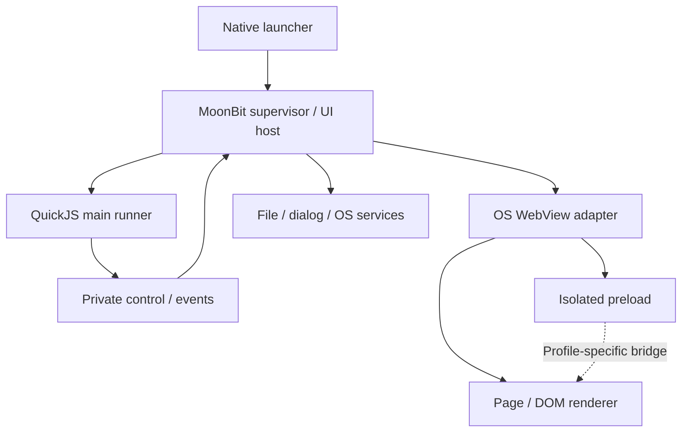

# 0006: 実用ランタイムの責務・プロファイル・状態設計

| 項目 | 内容 |
| --- | --- |
| 状態 | OPEN / 実装設計。記載する新規API・配置は提案、実装済みではない |
| 優先度 | P0 / 後続実装が共有する契約 |
| 基点 | main `30c6fc97186e7ecfc8397c799525f00c8e4f0f65`、2026-10-17 |
| 既存計画 | Issue 0001、PR #2 native host、PR #3 Node-less ADR、PR #10/#13 |
| 依存 | [0005 棚卸しと統合](0005-existing-work-and-integration.md) |
| 上位 | [0004 実用化ロードマップ](0004-production-readiness-roadmap.md) |

## 1. 実用化の対象を固定する

既存ElectronアプリのMain、preload、rendererを区別し、どの部分を変更したかを成果物で証明する。MoonBitを主言語とし、製品のNode-less経路ではQuickJSをMain用engine、WKWebViewをmacOSのDOM rendererとする。PR #3で選定されたQuickJS 2026-06-04を再選定せず、まず固定ソース・FFI・module実行・job処理を実証する。

Issue 0001と現行AGENTSが規定する実Node利用は既存 `desktop-core-v1` の契約として保持する。Node-lessは別profileであり、共通coreのテストを共有しても、Nodeの実行結果をQuickJSの互換実績へ転記しない。今後実装がAGENTSの対象を広げる際には、同じPRでこのprofileの適用範囲を明記する。

### 1.1 プロファイル台帳

| ID | Main | preload / bridge | 初期状態 | 表示できる達成 |
| --- | --- | --- | --- | --- |
| `desktop-core-v1` | 実Node | 厳密contextBridgeを目標 | M0 OPEN / `compatible:false` | Node-backed契約・実機probeの個別結果 |
| `electron-nodeless-v1` | QuickJS | 元preload、同期return/throwを含む厳密互換 | blocked。PR #3の初版No-Goを保持 | strict gateを新証拠で閉じた範囲だけ |
| `electron-nodeless-adapted-v1` | QuickJS | 監査済み生成adapter、列挙した非同期API | planned / 実装・実アプリ未検証 | `App Scenario Supported (adapted)` |
| `moonbit-native-v1` | MoonBit | 新規アプリ向け契約 | 別用途 / 今回の実用化判定対象外 | MoonBitアプリ実行。既存Electron互換ではない |

adaptedは既存PR #3にある実用経路であり、strict失敗時の暗黙fallbackではない。起動時に利用者またはpack設定がprofileを明示する。元preloadの差し替え、依存alias、TSビルド差分を別々に記録する。同期APIをPromiseに変えて元アプリを無改修と表示しない。

## 2. 製品プロセス構成

Node-lessの最初の製品候補は「MoonBit native supervisor/UI host + 別プロセスQuickJS main runner + OS WebView」とする。同一UIスレッドへのJS埋め込みは初期採用しない。無限JSや同期Main呼出しでAppKitのrun loopを塞がないためである。

PR #2の現在の実験系はNode側のcompiled MoonBit coreと、NodeがspawnするObjective-C hostである。上図はその現状図ではなくNode-less製品への移行先である。Node-backed検証系の親子関係を同時に反転させず、先に共通wire/authority契約を固定し、native coreが所有するproduct hostを独立fixtureで検証する。

OS WebViewのWebContent/GPU/network processはOSが管理する。全てがsupervisorの直接の子になるとは仮定しない。プロセス台帳は観測範囲と未帰属processを区別する。

### 2.1 所有者と境界

| 対象 | 唯一の論理所有者 | 薄いadapterが保持できる状態 |
| --- | --- | --- |
| app/window/document状態、権限、request終端 | MoonBit native core | OS objectと論理IDの対応、native callback token |
| Main JS object、closure、listener、Promise | QuickJS runner内のrealm | JSValueのretain/releaseとopaque handle |
| WKWebView/NSWindow | native UI thread | delegate、navigation object、frame observation |
| preload/page JS object | 各WebView world | そのrealm内の関数表とproxy。MainのJSValueと共有しない |
| module解決・profile許可・diagnostic分類 | MoonBit loader/policy | engine評価、OS open/read、JS descriptorのleaf操作 |
| browser DOM/CSS/layout/IME/AX | OS WebView | focus・resize・イベント受け渡し。独自DOMを作らない |
| 配布内容・version/provenance・evidence判定 | MoonBit CLI/manifest契約 | platform packaging/signingコマンド実行 |

raw native pointer、FD、JSValue、`WKFrameInfo` objectをwire IDとして公開しない。realm間に文字列化した関数本体を渡して評価しない。callback解放をGCの最終化タイミングだけに依存させない。

### 2.2 coreの重複を避ける

1. `core/runtime.mbt` のstate/ID/grant/pending契約を分離し、Node-backed JS buildとnative buildで同じ純粋ロジックをコンパイルする。
2. 一つの実行sessionで権限の正本は一箇所。Main runnerはwindow IDやcall tokenを持てるが、別のgrant台帳を正本として動かさない。
3. 関数参照はrealm ownerに残す。MoonBitは単調IDと登録順、期限、失効理由だけを管理する。
4. native callbacksは型付きeventに変換後coreへ投入する。OS objectの有効性はadapter、論理generationの有効性はcoreがそれぞれ検証する。
5. compiled JS exportを呼んだテストとnative FFIを通したテストの証跡を分ける。

## 3. モジュール配置と移行単位

以下の新規pathは実装予定。既存 `bridge/` と `bridges/` は役割が違うため、一括renameを前提にしない。

| path | 状態 | 設計責務 |
| --- | --- | --- |
| `core/` | 既存 | lifecycle、ID、shared resource budgets、比較・判定 |
| `bridge/` | 既存 | Node-backed compiled MoonBit境界、回帰を保持 |
| `transport/` | PR #2系で追加 | version/session/request/event、strict parsing、terminal correlation |
| `bridges/node/` | 既存・PRで拡張 | reference Main facade/JS identity。Node-less配布対象外 |
| `bridges/embedded-js/` | 新規予定 | QuickJS C ABI、eval/jobs/roots、JS leaf glue |
| `loader/` | 新規予定 | package graph、CJS/ESM解決、Node symbol allowlist |
| `host/` | 新規予定 | native supervisor、UI dispatch、resource owner、runner lifecycle |
| `security/` | 新規予定 | native sender context、policy、document grants |
| `host_services/` | 新規予定 | files、dialogs、clipboard、shell、Menu等 |
| `bridges/preload/` | 新規予定 | strict/adaptedごとの明示的境界 |
| `platform/macos/` | probe既存、hostはPR #2系 | AppKit/WKWebView public API adapter |
| `platform/windows/`, `platform/linux/` | 新規予定 | 独立したOS/renderer能力の実装 |
| `cmd/` | Node CLI既存 | native CLIは別entry。旧CLIの成功を代用しない |
| `compatibility/` | 既存 | profile、pin、API row、app scenario、immutable evidence |

機能ごとに `core contract → engine/native leaf → production wiring → differential → native fault → manifest` を一組にする。空interfaceだけを大量に公開しない。experimental exportとstable public APIを分離し、`.mbti` 等の公開面差分をレビューする。

## 4. 内部契約

### 4.1 起動handshake

1. native launcherがbundle・profile・依存manifestを検証し、app rootをdescriptor/不変snapshotとして固定する。
2. inherited private channelを作り、runnerを限定されたenv/cwdでspawnする。rendererへdescriptorやsession secretを継承しない。
3. handshakeでwire version、runtime build SHA、profile hash、engine version、最大frame size、codec IDを一致させる。
4. native UI準備とrunner側のCJS同期entry評価完了を合流させ、listener登録を取り逃さない地点でReadyへ遷移・通知する。JS評価完了だけをOS readyの代用品にしない。将来のESMはtop-level awaitで `app.whenReady()` を待つ場合を別fixtureにし、全Promise完了をready条件にして相互待ちしない。
5. 誤version・途中EOF・deadline超過・不正payloadはsessionを終端化する。同じchannelの復旧とrequest再送を自動実行しない。

Session ReadyとdocumentのRPC許可は別状態とする。documentの `requiredObservations` はprofile別variantにし、restricted-originalはPR #13のisolated preload観測と成功loadを使う。adaptedはindependent bootstrap、adapter installation、prepared routes/schema、actual native document identityを要求し、`originalPreloadExecuted:false` とadapter hashを記録する。元preloadを実行していないのにPR #13のattestation eventを生成しない。

adaptedの `DocumentIngressReady` はfull load ACKから分離し、初回page APIとの循環待ちを避ける。ただしload完了前のactual document識別は0007のnative gateが通るまで未証明であり、pageのready自己申告で代用しない。Moji初回RPCはMain admission前のbounded queueへ置き、timeout/revokeは一度だけrejectする。後のload failureはauthorityを失効するが、受理済みMain副作用を巻き戻したとは扱わない。

### 4.2 wire envelopeの概念型

wireを変更する実装時にschemaとfixtureを同じPRで固定する。下記は既存protocolの無断置換ではない。

| field | 検証・所有 |
| --- | --- |
| `protocolVersion`, `profileHash` | handshakeで一致した値のみ |
| `sessionId` | supervisorが生成。新sessionで再利用しない |
| `requestId` / `eventSequence` | 各laneで単調、重複・overflowを拒否 |
| `windowId`, `documentGeneration` | core発行のID。window-only operationは別variant |
| `operation` | profileで許されたclosed enum |
| `codecId`, `payloadLength` | decode前のbyte上限と合意codecを確認 |
| `payload` | operation別exact schema、unknown fieldの扱いもversion固定 |
| `terminal` | success/error/cancelled。副作用の取消を意味しない |

整数は元tokenの小数・指数・overflowも検査し、Doubleに丸めてIDを承認しない。session IDを持つこととnative frame認証を混同しない。詳しくは [0010 IPC](0010-ipc-values-and-flow-control.md)。

### 4.3 現行上限の引継ぎ

| budget | mainに存在する値 | 拡張時の扱い |
| --- | --- | --- |
| windows | 64 | 後続profileで実測変更。無制限化しない |
| channel | 128 code units | 不正surrogate/empty等のprofile制限を明示 |
| grants/document | 128 | reloadで失効、main listenerとは別 |
| payload | 1,048,576 bytes | encode結果/受信frame双方で検査 |
| tree depth / nodes | 64 / 100,000 | encode前後でtotal budgetに課金 |
| pending＋未配送cancel | 256 | adapter独自queueでも回避不能にする |
| queued bytes | 4,194,304 | requests/events/repliesのlane別＋合計を管理 |
| terminal history | 1,024 |履歴退避後もIDを再利用しない |

PR #9/#11/#12のlistener、handler、ticket上限は [0005](0005-existing-work-and-integration.md) の取り込み時に統一する。JS root、timer、module、open file、native event queueにも上限を追加し、全体memory budgetとの関係を示す。新数値は測定に基づく提案値としてversion管理する。

## 5. profile・実装・証拠を別フィールドにする

一つの `compatible` Booleanから「存在するAPI」「検証済みOS」「適応版アプリ」を逆算しない。現行manifest schemaは維持し、次版の読取・migrationを用意して拡張する。

| field | 値の例 | 意味 |
| --- | --- | --- |
| `implementation` | planned / partial / implemented / unsupported | コードの存在と範囲 |
| `verification` | not-run / invalid-evidence / failed / passed | 指定実行の結果 |
| `gate` | open / blocked / satisfied | profile全体の依存条件 |
| `scope` | unit / kernel / native-ingress / app-scenario / release | 何の検証か |
| `inputMode` | original-cjs / prepared-js / ts-build | Main/renderer入力の形態 |
| `preloadMode` | original / generated-adapter | preloadの適応を入力形態と独立に表現 |
| `dependencyAdaptations` | hash付きalias/置換の配列 | TS-buildとpreload-adaptedと依存適応を同時記録 |
| `runtime` | node-backed / quickjs-native | 実際に実行したengine |
| `environment` | OS/CPU/SDK/WebView、hash付き | 互換結果の適用範囲 |

required evidenceが欠けた行はpassed/verifiedに昇格できない。harness-errorとsemantic mismatchも区別する。`compatible:false`を既存manifestから消す作業は本設計に含めない。

## 6. gpui.mbt・Yami-kumoとの接続判断

最初の実用化ではPR #2が既に持つAppKit/WKWebView接続を活用し、generic WebView attachが完成するまで待たない。gpui.mbtはwindow/serviceの公開契約を再利用できるかを別の小さなadapter試験で判断する。`electron.mbt → gpui.mbt` の向きだけを許し、Electron IPCやNode module解決をgpuiのcoreへ持ち込まない。

rendererのDOM/CSSをgpuiの描画へ自動変換しない。Yami-kumoの共通Viewも既存Electronの任意DOM代替ではない。新規MoonBit native UIは別profileで実装できるが、Moji/jmdの移植成功として数えない。採用するgpui公開package/revisionは実装時に再確認する。

## 7. 実装分割と受入

1. profile schema/loaderおよび既存manifest migrationを追加し、unknown profileをrun前に拒否する。
2. pure coreをnative/JS両targetで同一fixtureに通し、sole authorityの配置を固定する。
3. Node-independent transportとnative supervisorを構築し、最小QuickJS runnerでhandshake/exit/faultを検証する。
4. real window lifecycleをnative coreへ接続し、Node-backedの同じexpected traceを比較する。
5. bridge/IPC/OS servicesをそれぞれの設計に従い追加し、scopeを狭く記録する。

| What | 受入証拠 |
| --- | --- |
| profileを変えるとengine・bridge・pack構成も一致して変わる | CLI JSON、binary/link/process audit |
| Nodeを除いた環境でlauncher/run/pack済appが動く | clean macOS arm64の実行記録 |
| 同じwindow/documentを複数の権限台帳が承認しない | core/native境界の競合・遅延fixture |
| host/runnerどちらが落ちてもrequestが一度だけ終端になる | fault log、owner/resource ledger |
| QuickJSの成功がstrict bridgeを昇格させない | manifest/CLI negative contract |
| 同じJS objectを別engineのpointerと誤認しない | ABI lifetime/invalid handle試験 |

## 8. 完了条件と出典

このissueは全profileが同時に完成するまで待たず、shared architecture/ownership/manifestの実装と受入が通れば設計対象部分を完了できる。strict blockedをsatisfiedへ移すには [0007](0007-context-bridge-feasibility-and-security.md) の独立判定を要する。

1. [現行main manifest](https://github.com/f4ah6o/electron.mbt/blob/30c6fc97186e7ecfc8397c799525f00c8e4f0f65/compatibility/manifest.json)
2. [PR #2 native host](https://github.com/f4ah6o/electron.mbt/pull/2)
3. [PR #3 Node-less ADRとtarget manifest](https://github.com/f4ah6o/electron.mbt/pull/3)
4. [PR #13 attestation](https://github.com/f4ah6o/electron.mbt/pull/13)
5. [Electron process model](https://www.electronjs.org/docs/latest/tutorial/process-model) — 公開概念の参照。適合判定には固定oracleを使う。
