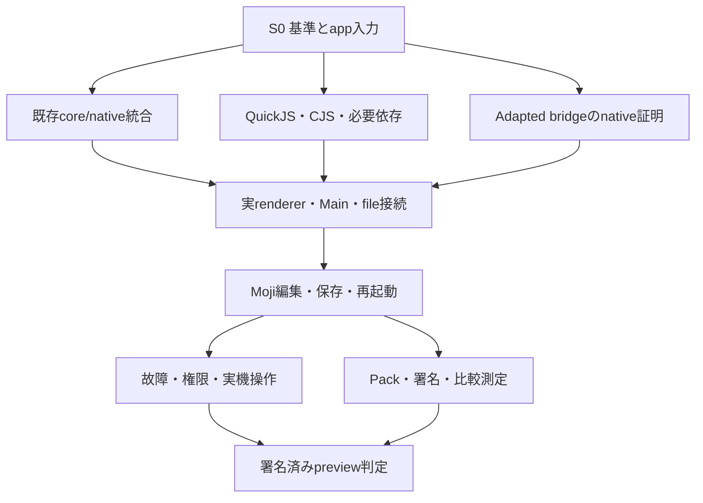

# 0004: electron.mbt 実用化ロードマップと実装設計の入口

Status: polished
Model: GPT-6 Astra Pro
Created: 2026-10-17
Updated: 2026-10-17
Branch: plan/issue-0004-production-roadmap

## 概要

macOS Apple Silicon 上で、固定 Moji の編集・保存・再起動を Node-less adapted profile で実証し、署名済み preview へ到達する計画を管理する。32個の work package、既存 PR の統合順、G0〜G5 の判定材料を一つの入口にする。

| 分類 | 内容 |
| --- | --- |
| 作業の性質 | 調査・設計・統合計画の親 issue。実装は0020の bounded EPへ分割 |
| 優先度 | P0: S0の誤成功修正、app入力、profileと所有権の確定 |
| 利用者への影響 | Mojiで実際に完了できる操作、明示adaptation、配布条件と未対応を把握できる |
| 影響する文書 | 0001の原要求、0005〜0021の契約・依存・証拠・停止条件 |
| 実装履歴 | 既存PRの成果・番号・修正履歴を保持。計画変更で未達の元要件を消さない |
| 最初の成果物 | EP-01の負例と修正、EP-05の固定build/boot inventory、更新したG0判定表 |

## 背景

### 2. 2026-10-17時点の評価

| 領域 | 直接確認できた状態 | 実用化に残るもの |
| --- | --- | --- |
| main | M0基盤、core、Node facade/transport、inventory、oracle/probes。`compatible:false`、通常run/packは拒否 | 実appのrun、pack、製品runtime、署名 |
| PR #2 | Draftの実AppKit/WKWebView host。mainとのmergeable=false | 最新main統合、残review triage、製品native supervisor |
| PR #8/#9/#11/#12 | baseline admission、main-local listener/invoke/undefined codec | 実renderer senderからのproduction wiring |
| PR #10/#13 | isolated bootstrap/lifetime、native one-shot attestation | arbitrary page requestのsender証明、adapted installation variant |
| PR #3 | Node-less/profile/QuickJS/app選定の設計。未merge | QuickJS FFI、scheduler、module/subset、actual app試験 |
| 全PR | 13件中8件open/Draft、5件merged。open全8件の最終HEAD CIはsuccess | stack同士を統合したSHAの回帰と新profileの受入 |
| GitHub Issues | 通常Issuesは0、`has_issues:false` | `issues/polished`内の整備済み文書とPRから作業を追跡 |
| 実アプリ | 固定Moji/jmdのsource/lock/APIを追加調査 | 実build出力、動的boot閉包、candidate E2E |
| 配布・性能 | root LICENSE未確定、pack/署名/製品比較未受入 | license方針、SBOM、Node不在端末、比較測定 |

根拠のHEAD、base、run ID、job/step、生ログ、review指摘は [0005](0005-existing-work-and-integration.md) に集約する。古いHEADの成功を将来の統合結果へ転記しない。

調査の実装基点は `30c6fc97186e7ecfc8397c799525f00c8e4f0f65`、最新の文書追加基点は `8177cf051976b8d7b9eca25ae7ad8820bb04a719`。後者は前者の runtime code を変更していない。PR情報は0005の固定HEADと取得時刻の範囲を使い、実装着手時に新しいHEADへ更新する。

## 問題

### 2.1 最初に直す品質の問題

PR #6のsync probe validatorは、候補7件の `observed:{}` を拒否すべき追加assertionに **FAIL** した。取得したmain同一ソースで `problems:[]` / `warnings:[]` を返すことを再現済み。既存のvalidator testsはPASSするため、既存CI greenだけではこの誤成功を検出できない。[D5]

同reviewのDOM clipboard opt-in外呼出し、NSNullをdictionaryとみなす経路も修正対象へ置く。ただしこの二つの実macOS再現は未実行で、静的確認とレビュー指摘を根拠にする。まず判定器が観測欠落を失敗にすることを確認してから、次のprobe結果でgateを判断する。

さらに、二つの PR stack は統合済みではなく、Mojiの実build/boot依存、早期native document proof、保存時の権限、配布license/署名/実機条件が未確定である。各論点を「後で対応」としたままS2以降を並行実装すると、契約の重複や受入できない結合が生じる。

## 目標

### 1. 実用化の方針

**実用化の最初の目標を、NodeなしのmacOSアプリとしてMojiの代表操作を安全に完了し、他のMacへ署名済み成果物を配れる状態に置く。** Main engineはPR #3で選定済みのQuickJS 2026-06-04、UIはAppKit/WKWebView、lifecycle・権限・transport・互換判定の正本はMoonBitとする。JSはrealm内の関数identityやengine境界に必要なleafへ限定する。

厳密な `electron-nodeless-v1` の同期contextBridgeは現時点で **blocked**。対象public APIと実証したfixtureに関する現状判断であり、全OS・将来の方式に対する不可能証明ではない。2026-10-18 の test-only B5 repaired-primitive spike は macOS 26.5.2 / WebKit `21624.2.5.11.8` で checkpoint 1/2 PASS・decision go を記録したが、これは Electron engine proxy ではなく、B6 の production loader・MoonBit authority/lifetime/bounds・native sender/document authority・独立 review は未達のため strict は blocked のまま。CI の Electron baseline differential も必要。既存の `electron-nodeless-adapted-v1` は、generated preload adapterと変更した依存・振舞いを明示した独立profileとして実装する。native sender/document/grantの受入に失敗した場合はadaptedもblockedにする。[P3], [D7]

0001の `desktop-core-v1` は実Nodeを用いる別経路として保持する。Node-lessの実装開始時に共存範囲と `AGENTS.md` の適用をADRで具体化し、既存Node経路を無断に置換しない。新規MoonBitアプリ向け `moonbit-native-v1` が動いても、既存Electronアプリの移行実績へ数えない。

### 3.2 Mojiのpreviewで必須にする操作

1. Node/SDKなしで起動し、元rendererの初期settings・update-state取得と3種類のevent登録を完了する。
2. readonlyの日本語guideを表示し、別の新規/テスト文書を実際に編集する。
3. native open dialog、複数選択、cancelでfile権限を正しく扱う。
4. saveAsに加え、open-for-editした文書の通常saveと同fileへの再saveを行い、UTF-8 bytesを照合する。
5. 再起動後にpickerから保存fileを再許可・再openし、再編集・通常saveする。settings/window boundsも検証する。
6. dirty close/quitのcancel/save/discard、日本語IME、Menu/clipboard、focus、基本VoiceOver操作を実機で確認する。
7. 正常終了とhost/Main/WebContent異常時に、data結果・pending・callback・owned process/FDを回収・診断する。

全操作の詳細は [0014](0014-real-app-acceptance.md)。初版のdata保護受入は隔離された通常fileと明示atomic-save policyに限定し、既存ユーザdataへ無検証で接続しない。読み取り専用guideのflagを外して編集を達成したことにしない。

## 対象外

### 3.3 初版で範囲を広げない項目

export/PDF/image、drag-dropの同期getPathForFile、任意local path、全面的session/protocol、autoUpdater互換、全Menu/Tray/notification、native addons、直接ESM、全npm互換、Windows/Linux GUIは独立gateへ残す。ただし画面操作を除外しても **起動時importは除外できない**。Mojiのeager `electron-updater`、`node:zlib`、Bufferはbuild後の閉包と明示adaptationで解決する。[D8], [D14]

jmd原本は起動時に `bypassCSP:true` のprivileged protocolを要求する。J1は明示拒否を確認するnegativeであり、二つ目の実アプリが動いたというpositive実績にはしない。

この issue を単一の巨大 runtime PR にしない。日程の確約、他OSの完成、全Node API、strictの安全条件の免除、署名済み成果物の公開自体は、この計画文書の整備で実行する作業に含めない。公開の資格判定と公開操作は§10のとおり分ける。

## 提案する方針

### 着手単位と変更を反映する場所

最初の2作業は独立して開始できる。EP-01は `scripts/differential.cjs` / `scripts/macos-probe.cjs` と対応テストを変更し、missing/null/不正baselineを拒否する。EP-05は予定の `compatibility/apps/` と `fixtures/apps/` に原本・emit・adapterを分けた入力台帳を作り、隔離したapp baselineを採取する。0005/0014の具体的入力を使い、既存appを別の容易なfixtureへ差し替えない。

EP-06は両作業の結果を用い、0006のprofile/authority schemaと0021 DEC-01/03を確定する。残作業の実装場所・入力・出力・依存は0020にある。計画の変更は関連するgate・EP・ADR・acceptanceを同じPRで修正し、履歴に変更理由と増減scopeを残す。

### 3. 最初に提供する範囲

#### 3.1 Profile別の約束

| profile | 入力と公開面 | 初期の表示・制約 |
| --- | --- | --- |
| `desktop-core-v1` | 実Node Main、無変更Electron fixtureの契約 | 既存M0の未達を保持。Nodeを容量・更新責任に含める |
| `electron-nodeless-v1` | Nodeなし、原本Main/preload/rendererの厳密な対象契約 | strict bridge gateが閉じるまでblocked |
| `electron-nodeless-adapted-v1` | QuickJS Main、準備済renderer、生成adapter、明示依存/振舞い差分 | 受入後もApp Scenario Supported (adapted)。全Electron互換としない |
| `moonbit-native-v1` | 新規MoonBitアプリと型付きnative API | 別開発者向け経路。移行互換の証拠へ流用しない |

`inputMode`はoriginal-cjs / prepared-js / ts-build、`preloadMode`はoriginal / generated-adapter、依存置換と保存policy等はadaptation manifestへ分ける。TypeScript buildとpreload適応は同時に起こり得る。原本sourceが同じでも生成JSやAPI意味論が変わった場合は変更を記録する。

### 4. 元のmilestoneとの対応

新しいS番号は実装の並行性と配布判定を整理するための製品stage。元のM/Nを置換・完了扱いにしない。

| 製品stage | 主な成果 | 0001との関係 | PR #3との関係 |
| --- | --- | --- | --- |
| S0: 基準・入力固定 | admission修正、app inventory、profile/owner | M0の基準・品質 | N0 |
| S1: 基盤と実現性 | 既存stack統合、QuickJS/native slice、strict判定 | M0/M1の未達を具体化 | N1aの部分実装、N2の基礎 |
| S2: 実appへ接続 | CJS/subset、adapted native IPC、file/services | M1/M2の契約を再利用。strict C/Fは別判定 | N1aのCJS受入、N1b-adapted、N2/N3 |
| S3: 日常操作 | Moji・故障・security・実機入力 | M3へ必要な実app証跡。無改修Jは未達を保持 | N4 |
| S4: 署名済preview | pack/license/sign/clean install/性能/手順 | M3配布・Iの証跡。strict全体完成ではない | N5 |
| S5: 運用・拡張 | update/rollback、OS、ESM、追加app | M4を別OS/機能ごとに受入 | N6 |

#### 4.1 A〜Jの追跡を失わない

| 元ID | 実装設計 | strictで必要な証拠 / adaptedの扱い |
| --- | --- | --- |
| A: module/source | 0008、0011、0014 | 原本/生成物/adapter hash、facade identity。TS emitと無変更配布は別 |
| B: lifecycle | 0009、0012 | 実native戻り値・例外・event・close/quit cancellation |
| C: preload/bridge | 0007、0010 | strict同期/隔離はblocked。adaptedは独立installation/local disposer proof |
| D: IPC | 0010 | 値型/例外/listener/必要orderとproduction sender。kernel成功だけでは不可 |
| E: OS services | 0011、0012 | fake contractと実dialog/file/clipboardの双方 |
| F: authority | 0007、0009、0010、0011 | native frame/document・偽装・reload/redirect/replay拒否 |
| G: native操作 | 0019 | 実IME/focus/DPI/AX。未実機項目は未実行 |
| H: failure | 0008、0009、0010、0011 | process/FD/root/terminal ledger、crash/timeout/fault |
| I: 軽量配布 | 0016、0017 | 実artifact、全取得量/関連process、cold/warm測定 |
| J: 無改修実app | 0014、0015 | 原本の必要契約が同一である実E2E。adapted Moji成功では元Jを閉じない |

### 5. 実装stageと出口

#### S0 — まず信頼できる基準を作る

**入口:** 現mainと全PRのsnapshot。**作業:** EP-01/05/06、EP-32の開始。

1. #8のbaseline admissionと#6の観測欠損/side effectを修正する。
2. Moji/jmdの実build出力・boot/first-useを取得し、updater/zlibを含む必要symbolと非対応を確定する。
3. appData隔離、source/build/adapter差分、profile別の必要証拠をmachine-readableにする。
4. native MoonBit正本とNode-backed共存のADRを実装前提として固定する。署名・license・実機担当を決める。

**出口 G0:** 欠測reportを拒否、source/lock/build pin、original/adapter差分、最初のapp操作、責任分界が揃う。動的閉包がunknownなら、そのshim範囲の見積りは暫定のままにする。

#### S1 — 既存成果を合わせてnative foundationを作る

**作業:** EP-02/03/04/07/08/09/10、EP-15の開始。core stackとnative stackを独立に統合し、同一revisionの回帰へ合流させる。

**出口 G1:** 固定QuickJSのFFI/GC/jobsと最小native window/private sync RPCが実行でき、Node/Node-APIに依存しないdevelopment sliceがある。strictは有限spikeのGo/No-Goと根拠を残す。失敗するAPIを空実装にしてS2へ渡さない。

PR #3のN1aにはCJS cache/cycle/identity等も含まれるため、N1aの完了はS2のEP-11該当fixtureまで揃った時点で判断する。S1完了をN1a全体の完了へ読み替えない。

#### S2 — 実rendererからMain・fileへつなぐ

**作業:** EP-11〜20。必要CJS/Node subset、adapted API、native sender、file/storage/OS services、CLIを一つのproduction pathへ接続する。

**出口 G2:** actual WKWebViewからQuickJS Mainへ一つの許可操作が通り、旧document・iframe・偽senderはMain副作用前に拒否される。DocumentIngressReadyをLoadCompleteから分け、Moji初回RPCは有限queueで待ち、onXは同期local disposerを返す。nativeの早期document proofが成立しない場合はgateを閉じない。

#### S3 — Mojiの日常操作と失敗復旧を実証する

**作業:** EP-21/22/23。M1〜M3のpositive、jmdのnegative、保存・終了・security・IME/focus/AXを実行する。

**出口 G3:** 同じcandidate SHAとapp/build/adaptation hashで必須操作がPASSし、data-loss/privilege/false-successの既知未解決がない。文書の読取・saveAsだけで通常saveと再起動を省略しない。表示はscopeを限定したadapted scenarioのままとする。

#### S4 — 他のMacで使える署名済みpreview

**作業:** EP-24/25/26/27、EP-32の配布条件確定。release artifactとevidenceを結び付ける。

**出口 G4:** Node/SDKなしのclean macOS arm64で署名・notarization・Gatekeeper、Moji操作、data隔離、明示full-bundle更新/復旧が確認済み。実artifactのSBOM/license、圧縮/展開/初回取得、cold/warm/全関連process、利用手順が揃う。公開は資格判定と別の操作である。

#### S5 — 継続利用と対応範囲の拡張

**作業:** EP-28/29/30/31。signed update/data migration/rollbackを先に固め、Linux GUI、Windows、直接ESM、二次app、追加Electron/Node APIを個別に増やす。

**出口 G5:** 一括の「全対応」を置かず、OS/CPU/WebView/profile/app/scenario単位で受入を追加する。system WebViewとQuickJS更新による既存scenarioの再検証を保守workflowへ組み込む。

### 6. Critical pathと並行開発

strict bridgeは別の有限spikeとして判定を残す。adaptedの進行条件は自身の安全性証明であり、strict成功を待つ依存にはしない。逆にstrictの未達を理由にadaptedのsender/frame検証を省かない。

| lane | 並行して担当すること | 統合時に揃える契約 |
| --- | --- | --- |
| core / 統合 | #8/#9/#11/#12、IDs/limits/codec、evidence | authority owner、wire/profile schema |
| engine / loader | QuickJS ABI/jobs/CJS/Node symbols、build input | Main API、error/identity、private RPC |
| native / bridge | #2/#10/#13、AppKit/WKWebView、sender、services | document lifetime、native ACK、grant、event |
| app / QA / release | actual app、negative/IME、pack/size/clean install | pin、同一SHA、artifact/evidence、manual gates |

同じcore/protocol/manifestを同時に大改造しない。interfaces/fixtureを先に共有し、統合担当が小さいPRを順序付ける。source-safeな試験fixtureの準備は依存gate前に進められるが、fake結果をproduction完了へ数えない。

### 7. 工数・日程の初期仮説

[0020](0020-implementation-work-packages.md)のS0〜S4に対応する28作業は、初期案を合計すると **135〜235人日**。既存runtime/OS/JS engineに習熟した3〜4 roleが継続して担当できる場合、**12〜22週程度の計画枠**を最初の見直し用に置く。これは納期の約束ではなく、未実装のruntimeと配布までを含む作業量の見積りである。

| 区間 | カレンダー枠案 | 再見積りの条件 |
| --- | --- | --- |
| S0 | 1〜2週 | 実build/boot閉包、license/署名環境 |
| S1 | 2〜4週 | #2競合、FFI/GC、同期transport、strict判定 |
| S2 | 4〜7週 | adapted早期sender proof、Node依存閉包、保存権限 |
| S3 | 3〜5週 | real app挙動、日本語入力、data/fault修正 |
| S4 | 2〜4週 | signing/clean device、pack dependency、性能未達 |
| S5 | 別見積り | 対象OS・API・appを選んでから積む |

stage内の並行作業を前提とし、単純に担当人数で総人日を割って終了日を確定しない。一人で進める場合は同じ範囲で27〜47実働週相当の作業量が基準となり、保守/待ち/調達で延び得る。EP-29〜31の数値は最初の拡張sliceだけで、全Windows/Linux/ESM互換の総工数ではない。

S0終了、QuickJS ABI通過、adapted native proof通過、最初のMoji E2E通過の4点で再見積りする。unsafe bridgeやunknown boot dependencyを抱えたまま日程だけを固定しない。

### 8. 既存PRを統合する手順

1. **品質の入口:** #8と#6残存指摘を先行。#5のbaseline validatorを二重実装しない。
2. **core stack:** #8 → #9 → #11 → #12。元branchの依存を保持して最新baseへ順に載せる。
3. **native stack:** #2 → #10 → #13。#2の競合解消で#4のdata/ready/quit/JSONと#7 pinを保全する。
4. **設計系統:** #3のQuickJS/profile/app決定と既存0002/0003を取り込み、今回のsource調査・sender/boot/save設計との差を明示する。
5. **合流:** 二つのstackが単独greenでも、同じ統合SHAでcore/native/Node/macOS/oracle/faultを再実行する。証拠にruntime/profileとactual/synthetic区分を付ける。

この設計タスクは既存PRをmergeしたことを意味しない。PR #2にあるoutdated未解決reviewを「現HEADのactive指摘0」だけで解決済みにしない。full SHA、runと具体的な再利用箇所は0005参照。

PR #2の `0002-m1-native-host-contract.md` とPR #3の `0002-node-less-electron-compatible-moonbit-roadmap.md` は番号が重複するが別文書。元pathを黙ってrename/deleteせず、document aliasで識別する。今回の新規文書は0004〜0021とし、既存リンクと履歴を保つ。

### 9. 実装設計の一覧

| 文書 | 決めること |
| --- | --- |
| [0005 既存作業と統合](0005-existing-work-and-integration.md) | 全PR・HEAD・base・CI・review、再利用と最初の修正 |
| [0006 構成とprofile](0006-runtime-architecture-and-profiles.md) | MoonBit/native/JSの所有権、process、manifest、公開面 |
| [0007 ContextBridge](0007-context-bridge-feasibility-and-security.md) | strict判定、adapted、native sender、同期disposer、33受入case |
| [0008 Engineとloader](0008-nodeless-runtime-and-module-loader.md) | QuickJS C ABI/GC/jobs/timers、CJS/Node subset/TS/ESM |
| [0009 Native lifecycle](0009-native-host-lifecycle-and-processes.md) | UI thread、load/ingress/paint、close/quit、process failure |
| [0010 IPCと値](0010-ipc-values-and-flow-control.md) | sender admission、codec、listener/handler、queue/取消 |
| [0011 Load・file・data](0011-app-loading-origin-and-storage.md) | snapshot/origin、file grants、通常save、atomic差、永続化 |
| [0012 OS services](0012-os-services-and-desktop-integration.md) | dialog/Menu/clipboard/shell、scope、日常APIの優先順位 |
| [0013 CLIと診断](0013-cli-diagnostics-and-developer-workflow.md) | native doctor/run/pack admission、exit/schema、dev workflow |
| [0014 実アプリ](0014-real-app-acceptance.md) | 固定Moji/jmd、実source/lock、boot、M1〜M3/J1、data保護 |
| [0015 Oracle・CI・証拠](0015-oracle-ci-and-evidence.md) | version/source/profile/evidence、判定、環境別CI |
| [0016 配布と更新](0016-packaging-release-and-updates.md) | bundle/sign/notarize/SBOM/license、clean install、rollback |
| [0017 性能](0017-performance-and-resource-budgets.md) | 実bytes/全process/cold-warm、wire上限、事前budget |
| [0018 他OS](0018-windows-linux-and-backend-contract.md) | Win32/WebView2、GTK/WebKitGTK、共通契約とOS別gate |
| [0019 入力とAX](0019-native-interaction-and-accessibility.md) | 日本語IME、focus、clipboard、DPI、VoiceOver、実機証跡 |
| [0020 実装作業](0020-implementation-work-packages.md) | 32作業、依存DAG、PR分割、変更箇所、What、工数 |
| [0021 判断・risk・保守](0021-decisions-risks-and-maintenance.md) | ADR、riskのtrigger/停止/再開、upstream/license/更新責任 |

## 受け入れ条件

### 10. 完了の扱い

**この設計作業の完了:** 既存issue/PRを追跡し、実装場所・依存・API/state・security/data・negative tests・配布/性能・終了条件をreview可能な文書として保存すること。整備済みの文書はユーザー指示に従って `issues/polished` に配置し、実装の受入条件は未達のまま保持する。

**製品previewの完了:** G0〜G4のrequired evidenceが同一source/profile/artifactの条件で揃うこと。runtime実装、Moji build/E2E、署名、性能の未実行を文書の整合性PASSで置換しない。

**厳密なElectron互換:** 0001の対象profileとA〜Jに必要な実証を満たした時にのみ別途判断する。adaptedで実用的な操作ができる成果は独立して報告し、strict未達を隠さない。

### 計画と製品ゲートの観測可能な条件

- [ ] Given 現mainと全open PRの固定snapshot、when 取り込み順を決める、then32 EPすべての根拠・直接依存・対象ファイル・観測する出口が追跡でき、未mergeのHEAD CIを統合結果へ転記しない。
- [ ] Given 0001のA〜JとPR #3のN gate、when S0〜S5へ対応付ける、then元の全義務が残り、N1aのCJS要件やstrict C/F/Jが別profileの成功で閉じられない。
- [ ] Given 欠損観測またはunknownのboot閉包、when G0を審査する、then不足項目・owner role・次の検証が列挙され、未決事項を成功値で埋めない。
- [ ] Given strict finite spikeがNo-Go、when adaptedの計画を進める、thenNo-Goの記録を保持したまま、adapted自身のnative sender/document/file gateで可否を判定する。
- [ ] Given G0〜G4のrequired evidence、when preview資格を判定する、then同一candidate/profile/build/adaptation/artifactに束縛され、NOT RUNや既知のprivilege/data-loss/false-successが残れば未達になる。
- [ ] Given scope・critical path・利用可能な担当roleが変わる、when stage計画を更新する、then人日レンジ・再見積り条件・残る制限を同じ変更で更新する。

## テスト計画

| 検証対象 | 手順 / 入力 | 期待結果 |
| --- | --- | --- |
| 文書構造 | 指定polish-issueの共通CLIで `validate --issue-root issues`。repository-rootをこのrepoへ指定 | 19件の必須metadata/sectionが揃い、pathとStatusが一致する |
| 要求の保存 | 0001のA〜Jを§4.1へ、0007 B1〜B7を0020へ、全EPを直接依存表へ照合 | orphan・欠番・矛盾したgate昇格がない |
| 依存と見積り | 0020のID一意性・参照先存在・循環なし・S0〜S4の28件を確認 | 32 EP / 74直接依存、135〜235人日という基準案を再計算できる。変更時は両文書を更新 |
| 既存PRの整合 | GitHub上のHEAD/base/stateと0005を再照合し、統合対象SHAを記録 | 新しい差分やreviewを古いsnapshotで上書きしない |
| Gateの判定演習 | 「No-Goのstrict」「native sender未実証のadapted」「別SHAのCI成功」「Moji通常save未試験」を各々G0〜G4へ入れる | strict調査の完了、adapted停止、証拠不一致、app未達を別理由として説明できる |
| Runtimeの受入 | 0020のEPで指定する既存commandsと実装後のnative/app/pack harnessを実行 | 実環境・command・exit・raw結果を0015形式にする。文書検証のPASSをruntimeへ移さない |

本issueの整備時点では新しいMoji build/E2E、署名、性能測定はNOT RUN。既存のNode/MoonBit/macOS CIは0005に固定し、変更した実装SHAで必要な範囲を再実行する。

## リスク

最も早く計画を変える要因は、evidenceの誤成功、Mojiの動的依存増分、adaptedの早期document証明、file write競合、実機・署名・license条件である。0021のR01〜R21とDEC-01〜11へowner・停止条件・再開証拠を結び付ける。

135〜235人日 / 12〜22週は不確実性を含む初期仮説であり、担当者の確保やnative実現性を裏付けた納期ではない。G0、QuickJS ABI、adapted native proof、初回Moji E2Eの節目で再計算する。blocking decisionの結果を待つ作業と、先に準備できるfixtureを分ける。

## 未解決の質問

| 質問 | 決めるrole / 材料 | 止める範囲と再開条件 |
| --- | --- | --- |
| Mojiの実build/bootに必要なupdater/zlib/Bufferとadaptationはどこまでか | App / Engine、EP-05の固定emitと動的trace | 必要shimの最終範囲とEP-12見積り。inventory完成後、差分manifestをレビューして再開 |
| LoadComplete前にnative actual documentを安全に認証できるか | Native / Security、0007/0010/0011のactual WKWebView正負例 | G2とadapted production ingress。first-call/load-blocking fixtureとsender偽装拒否を通した範囲のみ再開 |
| Node-backedとNode-lessのinstruction・owner・profile admissionをどう共存させるか | Maintainer / Core、EP-06とDEC-01/03 | 新profileのcode追加。原0001のscopeを保持したADRとschema確定後に再開 |
| 最初のsupported macOS/SDK・実機とrelease条件をどう固定するか | Platform / Release / repository owner、DEC-08〜11 | G3/G4の認定。環境matrix・本体license・署名主体・実component・復旧手順の確定で再開 |

これらの結論を本issueの文書整備だけで代決しない。EP-01、EP-05の調査と負例は着手可であり、今すぐ利用者へ回答を求めなければ進められない項目ではない。

## 変更履歴

- 2026-10-17: ユーザー指示により `issues/open` から `issues/polished` へ移動し、`Status: polished` と現行参照を同期。実装の準備状態・未解決事項・受入証拠は変更していない。

- 2026-10-17: 全既存PR・原0001を踏まえ、0004〜0021、S0〜S5、32 EPの初期実用化計画を作成。
- 2026-10-17: polish-issueで最初の変更単位・独立した受入条件・文書とruntimeの検証・実装前の質問を明示。原M/N/A〜Jと工数の根拠を維持。

## 注記

- 2026-10-17: ユーザー指示「mv to issues/polished」に従い、整備済みの計画を open から polished へ移動。未解決事項・依存条件・runtime の未受入は本文に保持する。

**準備状態:** S0のEP-01/05と計画維持は着手可。G2以降の製品受入は表の未解決事項と0020の直接依存を満たしてから進める。

**状態と配置:** 2026-10-17 のユーザー指示により `open` から `polished` へ移動した。現在の保存先は `issues/polished/0004-production-readiness-roadmap.md`。`polished` は計画の整備状態であり、runtime の受入や未解決事項の解消を示さない。着手は本文の準備状態・依存条件に従い、受入は [AGENTS.md](../../AGENTS.md) と各試験の実証で判断する。進捗と再開条件は本ファイルへ記録する。

`Branch` は次の作業用ブランチ案であり、作成済みではない。既存 PR を引き継ぐときは元の履歴を保ち、同内容を別実装として数えない。今回の変更は本文整備であり、既存 PR の merge、runtime の有効化、license 選択、release の実行を意味しない。

整備基準は指定された [polish-issue](https://github.com/f4ah6o/skills/blob/0f6bc769ccce0ce03c6db0457f6a0c2c8ccd3878/skills/polish-issue/SKILL.md)。確認した最新 main は [`8177cf0`](https://github.com/f4ah6o/electron.mbt/commit/8177cf051976b8d7b9eca25ae7ad8820bb04a719)。それ以前の source/PR/CI の固定 SHA は歴史的根拠として維持し、新 SHA の実行結果へ転記しない。

### 11. 出典

- [main基点](https://github.com/f4ah6o/electron.mbt/commit/30c6fc97186e7ecfc8397c799525f00c8e4f0f65)、[元の0001](0001-electron-compatible-lightweight-runtime.md)、[AGENTS.md](../../AGENTS.md)
- [P3: PR #3 Node-less設計](https://github.com/f4ah6o/electron.mbt/pull/3)、[PR #2 native host](https://github.com/f4ah6o/electron.mbt/pull/2)
- [D5: 全PR・review・実検証の棚卸し](0005-existing-work-and-integration.md)
- [D7: bridgeの公開API・実証範囲](0007-context-bridge-feasibility-and-security.md)
- [D8: QuickJS/Node一次資料とloader設計](0008-nodeless-runtime-and-module-loader.md)
- [D14: 固定appのsource/lock・API調査](0014-real-app-acceptance.md)

[P3]: https://github.com/f4ah6o/electron.mbt/pull/3
[D5]: 0005-existing-work-and-integration.md
[D7]: 0007-context-bridge-feasibility-and-security.md
[D8]: 0008-nodeless-runtime-and-module-loader.md
[D14]: 0014-real-app-acceptance.md
